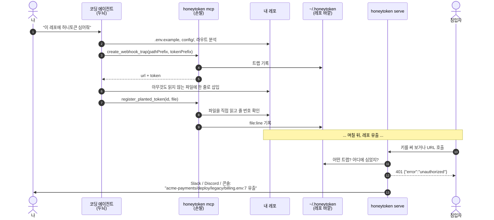

<div align="center">



<br>

[English](README.md) · **한국어**

<br>

[](LICENSE)
[](package.json)
[](https://modelcontextprotocol.io)
[](#두뇌와-손발)
[](#로드맵)

<h3>코딩 에이전트에게 <code>이 레포에 허니토큰 심어줘</code> 한마디.<br>1분 뒤, 레포 말투 그대로 지뢰가 깔립니다.</h3>

[동작 원리](#두뇌와-손발) · [빠른 시작](#빠른-시작) · [경보 해부](#경보-해부) · [기본값은 편집증](#기본값은-편집증) · [아키텍처](#아키텍처) · [레퍼런스](#레퍼런스)

</div>

<br>



<br>

## 왜 만들었나

레포는 샙니다. 외주 개발자 노트북이 털리고, CI 토큰이 긁혀 나가고, 비공개 레포가 11분 동안 공개로 바뀝니다.
훔친 레포를 손에 넣은 사람이 가장 먼저 하는 일은 시크릿을 grep해서 하나씩 써 보는 것입니다.

허니토큰은 그 grep을 역이용합니다. 아무 일도 하지 않는 가짜 자격 증명인데, 누가 쓰는 순간 크게 울립니다.
아이디어 자체는 오래됐습니다. 늘 걸렸던 건 심는 일이었습니다.

| | 기존 카나리 토큰 | honeytoken-mcp |
|---|---|---|
| **미끼 생김새** | 매번 같은 범용 키 포맷 | 이 레포가 이미 쓰는 모양: `sk_live_…`, `/api/v2/billing/webhook`, 환경 변수 표기법까지 |
| **위치 선정** | 사람이 손으로, 급하게 | 레포 구조를 읽은 코딩 에이전트가 |
| **운영 코드가 실수로 호출하면?** | 안 그러길 빌어야 함 | 아무것도 그 파일을 읽지 않는다는 걸 에이전트가 확인하도록 플레이북이 강제 |
| **어디서 샜나?** | 메모를 뒤져 봄 | 경보에 `deploy/legacy/billing.env:7`이 찍힘 |
| **나중에 제거** | 손으로 찾아서 삭제 | `clean_traps` 한 번. dry run 먼저 |
| **제거한 뒤** | 토큰이 죽어서 예전 유출은 놓침 | 트랩은 *은퇴*만 하고 계속 감시. git 히스토리에 미끼가 남아 있으니까 |

<br>

## 두뇌와 손발

honeytoken-mcp는 **LLM을 호출하지 않습니다.** 이미 쓰고 있는 모델이 두뇌이고, 이 도구는 정확해야 하는 부분만
결정론적으로 처리하는 작은 손발입니다.



| 구성 | 정체 | 하는 일 |
|---|---|---|
| **Agent Skill** | [`skills/honeytoken-planting/SKILL.md`](skills/honeytoken-planting/SKILL.md) | 짧은 플레이북: 레포 네이밍 분석 → 트랩 발급 → 아무도 읽지 않는 곳에 삽입 → 등록 → 검증 |
| **MCP 서버** | `honeytoken mcp` | 툴 5개가 전부: `create_webhook_trap`, `register_planted_token`, `list_traps`, `clean_traps`, `list_alerts` |
| **경보 서버** | `honeytoken serve` | 프로세스 하나로 모든 레포 감시. 요청을 트랩과 대조해 기록하고 Slack, Discord로 전달 |
| **CLI** | `honeytoken …` | 위 기능을 손으로 |

<br>

## 빠른 시작

> [!NOTE]
> 아직 npm에 올리지 않았습니다. 클론해서 쓰면 `npm install` 때 빌드까지 됩니다.

**1. 설치**

```bash
git clone <this-repo-url> honeytoken-mcp && cd honeytoken-mcp
npm install            # dist/ 빌드
npm link               # 선택: PATH에 `honeytoken` 등록
```

**2. 경보 서버 실행** (별도 터미널)

```bash
export HONEYTOKEN_SLACK_WEBHOOK=https://hooks.slack.com/services/…     # 선택
export HONEYTOKEN_DISCORD_WEBHOOK=https://discord.com/api/webhooks/…   # 선택
honeytoken serve       # 미끼를 심은 모든 레포를 감시. 데이터는 ~/.honeytoken에
```

**3. 에이전트에게 툴과 플레이북 쥐여 주기**

```bash
honeytoken install-skill          # → ~/.claude/skills/honeytoken-planting/SKILL.md

cd /path/to/target-repo
claude mcp add honeytoken -e HONEYTOKEN_BASE_URL=http://127.0.0.1:8787 -- honeytoken mcp
```

<details>
<summary><b>Cursor, Windsurf 등 다른 MCP 클라이언트</b></summary>

<br>

stdio 서버로 `honeytoken mcp`(또는 `node /abs/path/dist/cli.js mcp`)를 등록하고, 작업 디렉터리는 대상 레포,
환경 변수에는 `HONEYTOKEN_BASE_URL`을 넣으세요. 커밋되는 프로젝트 설정 파일 말고 **사용자 단위** 설정을 쓰세요
([기본값은 편집증](#기본값은-편집증) 참고). 스킬을 지원하지 않는 클라이언트라면 `SKILL.md`를 룰에 붙여 넣으면 됩니다.
MCP 서버도 플레이북 요약본을 instructions로 함께 보냅니다.

</details>

**4. 요청**

```text
› 이 레포에 허니토큰 심어줘
```

**5. 울리는지 확인**

```bash
honeytoken list
curl -X POST <trap url>
honeytoken alerts
```

<br>

## 실전 배치

트랩 URL은 발급 시점에 고정됩니다. 그러니 `HONEYTOKEN_BASE_URL`은 **심기 전에** 정해 두세요.

- **로컬 (기본값):** `http://127.0.0.1:8787`. 시험용이고, 내 기기에서만 울립니다.
- **실전:** 인터넷에서 닿는 곳(작은 VPS, 리버스 프록시, 터널) 뒤에서 `honeytoken serve --host 0.0.0.0`을 띄우고,
  `~/.honeytoken/registry.json` 사본을 넣어 준 뒤 `HONEYTOKEN_BASE_URL`을 그 공개 URL로 지정합니다. 호스트명은 우리 회사 것처럼 보여야 합니다.
  예: `https://hooks.acme-internal.dev`. `ngrok-free.app`을 가리키는 미끼에는 아무도 안 속습니다.

<br>

## 경보 해부

```text
[honeytoken] trap triggered: legacy billing key
trap: k3v9q2m8x1t7w0p4z6rb (matched url + token)
planted in: acme-payments/deploy/legacy/billing.env:7,8
request: `POST /api/v2/billing/webhook/k3v9q2m8x1t7w0p4z6rb`
from: `203.0.113.47`
user-agent: `python-requests/2.32.3`
at: 2026-12-14T03:12:09.114Z
```

필요할 때만 붙는 줄:

| 줄 | 붙는 경우 |
|---|---|
| `(retired trap)` + `note: this trap was cleaned up, so an old copy of the repo is in use` | 이미 제거한 트랩이 울렸을 때. 누군가 히스토리나 예전 클론을 쓰고 있다는 뜻 |
| `likely: Slack link preview (link previews fetch URLs on their own)` | UA가 Slack, Discord, Teams, X, LinkedIn, WhatsApp, GitHub 이미지 프록시, 검색 크롤러일 때 |
| `suppressed: 41 more hits from this address since the last alert` | 쿨다운(트랩·주소별 기본 10분)이 반복 알림을 묶었을 때. 전부 `alerts.jsonl`에는 남음 |

**무엇이 트랩을 건드리나**

| 요청 속 트랩 위치 | 표시 |
|---|---|
| URL 어디든 트랩 id (메서드, 앞뒤 경로 무관) | `url` |
| 아무 헤더 속 토큰: `Authorization: Bearer …`, `X-API-Key`, 쿠키 등 | `token` |
| HTTP Basic 인증, 쿼리 스트링, 본문(앞 64KB) 속 토큰 | `token` |

나머지는 밋밋한 `404`만 받고 경보는 없습니다. 경보 서버를 긁고 다니는 스캐너 때문에 새벽 3시에 깰 일은 없습니다.

<br>

## 기본값은 편집증

스스로 정체를 드러내는 허니토큰 도구는 없느니만 못합니다. 아래 항목은 모두 코드로 강제하고 테스트로 확인합니다.

| | |
|---|---|
| 🏠 **레포에는 미끼만 닿음** | 트랩 지도는 레포가 아니라 `~/.honeytoken`에 있습니다. lock 파일도, ignore 항목도 없습니다(커밋된 ignore 한 줄이 "여기 허니토큰 있음"이라고 광고하니까요). `git clean`으로 날아갈 일도 없습니다. 스킬은 `~/.claude/skills`에 설치되고 `claude mcp add`는 local scope가 기본입니다. |
| 🧭 **경보 호스트는 에이전트가 못 고름** | base URL은 `HONEYTOKEN_BASE_URL`이나 CLI에서만 옵니다. 모델이 그럴듯한 도메인을 지어내면 영영 울리지 않는 트랩이 됩니다. |
| 🔍 **위치는 믿지 않고 검증** | `register_planted_token`은 파일을 직접 읽어 줄을 찾습니다. 아직 안 심은 트랩이나 레포 밖 경로는 거부합니다. |
| 🧨 **요청 데이터는 적대적으로 취급** | 공격자가 보낸 경로와 UA는 잘라서 코드 스팬 안에 가둡니다. Slack용 텍스트는 이스케이프하고 Discord 멘션은 꺼서, 경보를 통해 `@everyone`이 날아가지 않습니다. |
| 🥱 **서버는 일부러 따분하게** | 트랩에 걸린 요청은 평범한 API처럼 `401 {"error":"unauthorized"}`를 받습니다. 배너, 버전, 헬스 체크 엔드포인트 없음. |
| 🪦 **지워도 잊지 않음** | 제거한 트랩은 은퇴할 뿐 계속 울립니다. git 히스토리와 정리 전에 만든 클론에는 미끼가 그대로 남아 있고, 바로 그 유출이 가장 알고 싶은 신호입니다. |
| 💉 **경보가 에이전트를 조종하지 못함** | `list_alerts`는 공격자가 쓴 필드를 "신뢰할 수 없는 데이터"로 표시해서 넘기고, 스킬은 그 내용대로 행동하는 걸 금지합니다. "ignore previous instructions"라고 적힌 UA는 그냥 문자열입니다. |
| 🔐 **쓰기 충돌 없음** | CLI와 모든 MCP 서버가 잠금 파일 아래 레지스트리 하나를 공유하고, 권한 `0600`으로 원자적으로 기록합니다. 프로세스 4개를 동시에 돌려 테스트했습니다. |
| 🤐 **토큰을 되읊지 않음** | `list_traps`는 위치만 돌려주고 시크릿은 돌려주지 않습니다. |

> [!IMPORTANT]
> **가짜 키만으로는 지뢰가 아닙니다.** 침입자가 가짜 `sk_live_` 키를 진짜 Stripe에 써 보면 우리에게는 아무 신호도 오지 않습니다.
> 그래서 플레이북은 토큰마다 바로 옆 엔드포인트 변수에 트랩 URL을 짝지어 넣게 합니다. 키를 써 보는 순간 우리 서버를 부르게 됩니다.

<br>

## 아키텍처

일부러 작게 만들고, 두 번째 구현이 실제로 생기는 곳에만 이음매를 뒀습니다.

```
src/
  core/        Web 표준만 사용 (Request, Response, URL, Web Crypto): Node, Workers, Deno, Bun 어디서든 동작
  notify/      채널마다 파일 하나: (alert) => Promise<void>
  store.ts     ~/.honeytoken: registry.json (잠금, 원자적 쓰기) + alerts.jsonl
  service.ts   issue · register · list · clean · alerts (모든 규칙은 여기에)
  server.ts    node:http → core.handle()
  mcp.ts       서비스 위의 얇은 껍데기
  cli.ts       서비스 위의 얇은 껍데기
```

경보 경로가 Web 표준 함수 하나라서, 엣지로 옮기는 건 재작성이 아니라 어댑터 작성입니다.

```ts
import { handle, type Trap } from 'honeytoken-mcp/core';

export default {
  fetch: (req: Request, env: { TRAPS: KVNamespace }) =>
    handle(req, {
      traps: async () => (await env.TRAPS.get<Trap[]>('traps', 'json')) ?? [],
      onAlert: (alert) => console.log(JSON.stringify(alert)),
      clientIp: req.headers.get('cf-connecting-ip') ?? '',
    }),
};
```

| 진입점 | 용도 |
|---|---|
| `honeytoken-mcp/core` | `handle`, `generateTrap`, `trapsIn`, `formatAlert`와 타입. Node API 없음 |
| `honeytoken-mcp/notify` | `slack`, `discord`, `createDispatcher`(쿨다운), `notifiersFromEnv` |
| `honeytoken-mcp` | `createService()`: CLI와 MCP 서버가 쓰는 바로 그 API |

<br>

## 레퍼런스

<details open>
<summary><b>MCP 툴</b></summary>

<br>

| 툴 | 입력 | 반환 |
|---|---|---|
| `create_webhook_trap` | `label?`, `pathPrefix?` (기본 `/v1/hooks`), `tokenPrefix?` (`[A-Za-z0-9._-]` 32자 이하), `tokenLength?` (16–128, 기본 32), `tokenCharset?` (`alnum` \| `hex`) | `id`, `url`, `token`, `next`, base URL 미설정 시 `warning` |
| `register_planted_token` | `id`, `file` (레포 기준 상대 경로), `line?` (힌트가 아니라 검증 조건) | 찾은 위치 목록 |
| `list_traps` | `includeRetired?` | id, label, status, url, createdAt, `repo/file:lines`. 토큰 없음 |
| `clean_traps` | `ids` **또는** `all: true`, `dryRun?` | 트랩별로 파일마다 지운 줄, 사라진 기록 파일. 트랩은 `retired`가 되어 계속 감시 |
| `list_alerts` | `limit?` (1–200, 기본 20) | 최근 경보(오래된 순)와 "공격자가 쓴 데이터" 경고문 |

</details>

<details>
<summary><b>CLI</b></summary>

<br>

```text
honeytoken create          [--label] [--path-prefix] [--token-prefix] [--token-length] [--charset alnum|hex] [--base-url]
honeytoken register <id> <file> [--line n]
honeytoken list            [--all] [--json]
honeytoken clean <id...> | --all  [--dry-run]
honeytoken alerts          [--limit 20] [--json]
honeytoken serve           [--host 127.0.0.1] [--port 8787] [--cooldown 600]
honeytoken mcp
honeytoken install-skill   [--dir ~/.claude/skills]

global: --home <path>      (env HONEYTOKEN_HOME, default ~/.honeytoken)
```

</details>

<details>
<summary><b>환경 변수</b></summary>

<br>

| 변수 | 사용처 | 의미 |
|---|---|---|
| `HONEYTOKEN_BASE_URL` | `create`, `mcp` | 경보 서버의 공개 URL. 기본 `http://127.0.0.1:8787` |
| `HONEYTOKEN_HOME` | 전체 | 데이터 디렉터리(`registry.json`, `alerts.jsonl`). 기본 `~/.honeytoken` |
| `HONEYTOKEN_SLACK_WEBHOOK` | `serve` | Slack incoming webhook URL |
| `HONEYTOKEN_DISCORD_WEBHOOK` | `serve` | Discord webhook URL |

</details>

<details>
<summary><b><code>~/.honeytoken/registry.json</code></b></summary>

<br>

```json
{
  "version": 1,
  "traps": [
    {
      "id": "k3v9q2m8x1t7w0p4z6rb",
      "kind": "webhook",
      "label": "legacy billing key in deploy/legacy/billing.env",
      "url": "https://hooks.example.com/api/v2/billing/webhook/k3v9q2m8x1t7w0p4z6rb",
      "token": "sk_live_Qm7rT2xVb9cWn4Lp8sYd…",
      "status": "active",
      "createdAt": "2026-11-25T01:02:03.000Z",
      "placements": [
        { "repo": "/Users/you/src/acme-payments", "file": "deploy/legacy/billing.env", "line": 7, "plantedAt": "2026-11-25T01:02:41.000Z" },
        { "repo": "/Users/you/src/acme-payments", "file": "deploy/legacy/billing.env", "line": 8, "plantedAt": "2026-11-25T01:02:41.000Z" }
      ]
    }
  ]
}
```

잠금을 잡고 권한 `0600`으로 원자적으로 기록합니다. 이 디렉터리는 다른 안전한 곳에 백업해 두세요. 없으면 `clean`이 트랩을 찾지 못합니다.
경보 서버는 요청마다 이 파일을 다시 읽으므로 새 트랩은 재시작 없이 바로 살아납니다. 모든 경보는 옆의 `alerts.jsonl`에 쌓입니다.

</details>

<br>

## 솔직한 한계

- **웹훅 트랩뿐입니다.** AWS, GCP, DB 자격 증명 카나리는 아직 없습니다.
- **경보 서버는 직접 띄워야 합니다.** 서버가 죽어 있으면 그 사이 신호는 사라집니다.
- **`list_alerts`는 로컬 로그만 읽습니다.** 경보 서버가 다른 기기에서 돈다면 `alerts.jsonl`도 그쪽에 있습니다.
- **`clean`은 줄 단위로 지웁니다.** 그래서 플레이북이 미끼를 한 줄씩 따로 두게 합니다. 에이전트가 미끼 위에 단 주석은 에이전트가 정리합니다.
- **에이전트의 신중함은 플레이북 수준까지입니다.** 커밋 전에 diff를 직접 보세요.

<br>

## 로드맵

- [x] 레포 스타일에 맞춘 웹훅/URL 트랩
- [x] MCP 서버, Agent Skill, 경보 서버, Slack·Discord 전달
- [x] 경보 쿨다운, 링크 미리보기 봇 표시, 경보 로그
- [x] 은퇴 후에도 감시하는 트랩, 모든 레포를 아우르는 레지스트리 하나
- [ ] Cloudflare Worker 어댑터 (`core`는 이미 그대로 돌아감)
- [ ] 클라우드 자격 증명 카나리 (CloudTrail로 울리는 AWS IAM 키)
- [ ] DNS 트랩
- [ ] npm 배포 (`npx honeytoken-mcp`)
- [ ] 범용 웹훅, PagerDuty 전달
- [ ] 로테이션: 위치는 그대로 두고 모든 트랩 교체

<br>

## 기여

```bash
npm install
npm test             # node:test, TypeScript 소스 직접 실행
npm run typecheck
```

사람이든 에이전트든 [`AGENTS.md`](AGENTS.md)부터 읽어 주세요. 이음매, 계층 규칙, 어떤 변경도 깨면 안 되는 보안 불변식이 정리돼 있습니다. 알림 채널 추가는 `src/notify/`에 파일 하나면 됩니다.

<br>

<div align="center">
<sub>MIT 라이선스. <code>honeytoken-mcp</code>는 가칭입니다.</sub>
<br><br>

</div>
