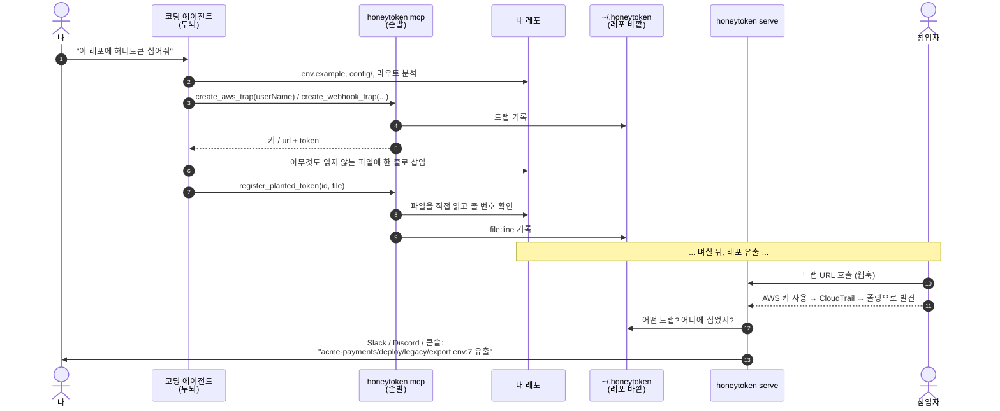

<div align="center">


<br>

[English](README.md) · **한국어**

<br>

[](LICENSE)
[](package.json)
[](https://modelcontextprotocol.io)
[](#두뇌와-손발)
[](#로드맵)

<h3>코딩 에이전트가 심는 카나리.<br>에이전트를 감시하는 또 하나의 카나리가 아닙니다.</h3>

<p><code>이 레포에 허니토큰 심어줘</code> 한마디면, 1분 뒤 권한 없는 진짜 AWS 키와 사내 서비스처럼 생긴 웹훅 트랩이<br>침입자가 들여다볼 자리에 레포 말투 그대로 깔리고, 기록되고, 점검됩니다.</p>

[동작 원리](#두뇌와-손발) · [트랩 두 종류](#트랩-두-종류) · [빠른 시작](#빠른-시작) · [경보 해부](#경보-해부) · [기본값은 편집증](#기본값은-편집증) · [레퍼런스](#레퍼런스)

</div>

<br>


<br>

## 왜 만들었나

레포는 샙니다. 외주 개발자 노트북이 털리고, CI 토큰이 긁혀 나가고, 비공개 레포가 11분 동안 공개로 바뀝니다.
훔친 레포를 손에 넣은 사람이 가장 먼저 하는 일은 시크릿을 grep해서 하나씩 써 보는 것입니다.

허니토큰은 그 grep을 역이용합니다. 아무 일도 못 하는 자격 증명인데, 누가 쓰는 순간 크게 울립니다.
아이디어 자체는 오래됐습니다. 늘 걸렸던 건 심는 일이었습니다.

> **헷갈리지 마세요.** 2026년에 쏟아진 도구들 상당수는 *말 안 듣는 AI 에이전트*(프롬프트 인젝션, 유출)를 잡으려고 카나리를 심습니다.
> Honeytokens as Code는 반대 방향입니다. 에이전트는 내 편이고, 카나리는 내 레포나 CI, 노트북을 훔친 사람을 위한 것입니다.


| | 기존 카나리 토큰 | Honeytokens as Code |
|---|---|---|
| **미끼 생김새** | 같은 범용 키를 같은 자리에 | 레포의 다른 서비스 계정처럼 이름 붙인 진짜 AWS 키, 또는 레포의 사내 서비스처럼 꾸민 엔드포인트와 토큰 |
| **위치 선정** | 사람이 손으로, 급하게 | 레포 구조를 읽은 코딩 에이전트가 |
| **운영 코드가 실수로 호출하면?** | 안 그러길 빌어야 함 | 아무것도 그 파일을 읽지 않는다는 걸 에이전트가 확인하도록 플레이북이 강제 |
| **어디서 샜나?** | 메모를 뒤져 봄 | 경보에 `acme-payments/deploy/legacy/export.env:7`이 찍힘 |
| **신선도 유지** | 아무도 기억 못 함 | `check_traps`가 사라졌거나 오래된 트랩을 잡고, `rotate_trap`이 그 자리에서 교체 |
| **제거한 뒤** | 토큰이 죽어서 예전 유출은 놓침 | 트랩은 *은퇴*만 하고 계속 감시. git 히스토리에 미끼가 남아 있으니까 |

<br>

## 두뇌와 손발

Honeytokens as Code는 **LLM을 호출하지 않습니다.** 이미 쓰고 있는 모델이 두뇌이고, 이 도구는 정확해야 하는 부분만
결정론적으로 처리하는 작은 손발입니다.



| 구성 | 정체 | 하는 일 |
|---|---|---|
| **Agent Skill** | [`skills/honeytoken-planting/SKILL.md`](skills/honeytoken-planting/SKILL.md) | 짧은 플레이북: 레포 네이밍 분석 → 트랩 종류 선택 → 아무도 읽지 않는 곳에 삽입 → 등록 → 검증 |
| **MCP 서버** | `honeytoken mcp` | 툴 8개: 생성(`aws`, `webhook`), `register_planted_token`, `list_traps`, `check_traps`, `rotate_trap`, `clean_traps`, `list_alerts` |
| **경보 서버** | `honeytoken serve` | 프로세스 하나로 모든 레포 감시. 웹훅 요청에 응답하고, CloudTrail에서 AWS 키 사용을 찾고, 기록하고, Slack·Discord로 전달 |
| **CLI** | `honeytoken …` | 위 기능을 손으로 |

<br>

## 트랩 두 종류

| | 🔑 **AWS** | 🪝 **웹훅** |
|---|---|---|
| **심는 것** | **내** AWS 계정의 IAM 사용자에게 발급한 진짜 접근 키. 모든 걸 거부하는 deny 정책이 붙어 있음 | 경보 서버의 URL과 토큰을 사내 서비스처럼: `BILLING_GATEWAY_URL` 옆의 `pgw_live_…` |
| **울리는 때** | 그 키로 하는 모든 AWS 호출. `sts get-caller-identity`도 포함. CloudTrail에서 발견 | URL로 오는 모든 요청, 또는 토큰을 실은 요청 |
| **속도** | 수 분 (CloudTrail 전달 + 폴링 주기) | 즉시 |
| **검증된 키만 남기는 도구도 잡나** | ✅ 키가 진짜라서, 검증하는 순간이 곧 경보 | ❌ 검증할 대상이 없음 |
| **필요한 것** | IAM 사용자를 만들 수 있는 계정에 로그인된 `aws` CLI | 없음. 진짜 침입자를 잡으려면 공개 URL |

이 구분은 기존 카나리 제품들의 방식을 따릅니다. Thinkst Canarytokens와 GitGuardian Honeytoken은 진짜 AWS 키를 발급하고
CloudTrail로 사용을 감지합니다(권한 없는 IAM 사용자라는 발상은 Rapid7이 2016년에 정리했습니다). 그 밖의 경우에는 Thinkst도 URL 토큰을 씁니다.

> [!IMPORTANT]
> **외부 서비스의 키를 흉내 내지 마세요.** 직접 확인했습니다. GitHub push protection은 Stripe, Slack, OpenAI, Anthropic,
> GitHub, npm, SendGrid, Discord, AWS 키 포맷을 감시하고 공개 레포에서 기본으로 켜져 있어서, 가짜 `sk_live_` 키를 심는 커밋은 막힙니다.
> TruffleHog 같은 스캐너는 키를 실제 서비스에 검증해 보고 무효한 키를 버리며, 가짜 Stripe 키를 본 침입자는 우리 URL이 아니라 Stripe를 부릅니다.
> 그래서 이 도구는 그런 포맷(`sk_live_`, `ghp_`, `xoxb-`, `AKIA`, `sk-ant-`, …)을 거부합니다. 운영자가 CLI에서 명시적으로 허용할 때만 예외입니다.

<br>

## 빠른 시작

> [!NOTE]
> 아직 npm에 올리지 않았습니다. 그때까지는 클론해서 `npm install && node dist/cli.js init`으로 쓰세요
> (또는 `npm link` 한 번 뒤 `honeytoken init`).

**1. 설정** (기기당 한 번)

```bash
npx honeytokens-as-code init
```

```text
✓ skill   ~/.claude/skills/honeytoken-planting/SKILL.md
✓ mcp     registered with Claude Code (user scope: no file in any repo)
✓ aws     AWS account 123456789012 reachable. Permissions needed: `honeytoken iam-policy issuer`
· alerts  HONEYTOKEN_BASE_URL is not set: webhook traps only fire on this machine. AWS traps need no public URL.
· next    Open your repo in Claude Code and say: plant honeytokens in this repo
```

`init`은 에이전트 스킬을 설치하고, MCP 서버를 Claude Code에 사용자 단위로 등록하고, AWS CLI를 확인합니다.
`--dry-run`으로 미리 볼 수 있고, Claude Code가 없으면 다른 MCP 클라이언트용 설정을 출력합니다.

**2. 감시** (하나 고르기)

```bash
honeytoken watch       # AWS 트랩만. 서버도, 열린 포트도 없음
honeytoken serve       # AWS 트랩 + 웹훅 트랩 (127.0.0.1:8787에서 대기)
```

아무것도 띄우지 않고 GitHub Actions 예약 실행으로 AWS 트랩을 감시할 수도 있습니다.
[서버 없이 AWS 트랩 감시하기](#서버-없이-aws-트랩-감시하기)를 보세요. Slack·Discord 전달은
`HONEYTOKEN_SLACK_WEBHOOK`, `HONEYTOKEN_DISCORD_WEBHOOK`입니다.

<details>
<summary><b>AWS 트랩 쓰기</b></summary>

<br>

AWS 트랩은 이미 쓰고 있는 `aws` CLI를 그대로 씁니다. 평소 프로필, SSO, 환경 변수(`AWS_PROFILE` 등)가 그대로 적용됩니다.
가능하면 조직 안의 **카나리 전용 계정**을 가리키게 하세요. 카나리 사용자만 사는 계정입니다.

트랩을 발급하는 쪽(`create aws`, `rotate`, `clean`, `check`)에는 `sts:GetCallerIdentity`와
`iam:CreateUser`, `iam:PutUserPolicy`, `iam:GetUserPolicy`, `iam:DeleteUserPolicy`, `iam:CreateAccessKey`,
`iam:ListAccessKeys`, `iam:DeleteAccessKey`, `iam:DeleteUser` 권한이 필요합니다. `honeytoken serve`를 돌리는 쪽에는
`cloudtrail:LookupEvents`와 `ec2:DescribeRegions`가 필요합니다.

모든 트랩 사용자에는 모든 걸 거부하는 인라인 정책이 붙고, 이 정책은 **키를 만들기 전에** 붙습니다. 발급이 중간에 실패하면 사용자를 다시 지웁니다.

</details>

<details>
<summary><b>Cursor, Windsurf 등 다른 MCP 클라이언트</b></summary>

<br>

stdio 서버로 `honeytoken mcp`(또는 `node /abs/path/dist/cli.js mcp`)를 등록하고, 환경 변수에 `HONEYTOKEN_BASE_URL`을 넣으세요.
커밋되는 프로젝트 설정 파일 말고 **사용자 단위** 설정을 쓰세요([기본값은 편집증](#기본값은-편집증) 참고).
스킬을 지원하지 않는 클라이언트라면 `SKILL.md`를 룰에 붙여 넣으면 됩니다. MCP 서버도 플레이북 요약본을 instructions로 함께 보냅니다.

</details>

**3. 요청**

```text
› 이 레포에 허니토큰 심어줘
```

**4. 울리는지 확인**

```bash
honeytoken list
curl -X POST <trap url>                                              # 웹훅: 즉시
AWS_ACCESS_KEY_ID=… AWS_SECRET_ACCESS_KEY=… aws sts get-caller-identity   # AWS: 몇 분 뒤
honeytoken alerts
```

**5. 신선하게 유지**

```bash
honeytoken check       # 아직 심겨 있나? 교체할 때인가? AWS 키는 멀쩡한가? 아니면 exit 1 (CI에 붙이기 좋음)
honeytoken rotate <id> # 같은 줄에 새 값. 예전 값은 계속 감시
```

<br>

## 서버 없이 AWS 트랩 감시하기

AWS 트랩은 대기하는 서버가 필요 없습니다. 사용 기록이 CloudTrail에 남으니, CloudTrail을 읽을 수 있는 무엇이든 경보를 울릴 수 있습니다.
**비공개 운영용 레포**(미끼를 심은 레포는 절대 아님)의 GitHub Actions 예약 실행이면 충분합니다.

1. **역할:** 카나리 계정에 운영 레포가 GitHub OIDC로 맡을 수 있는 IAM 역할을 만들고 `honeytoken iam-policy watcher`를 붙입니다
   (`cloudtrail:LookupEvents`, `ec2:DescribeRegions`뿐).
2. **시크릿**(운영 레포): `HONEYTOKEN_AWS_ROLE`(역할 ARN), `HONEYTOKEN_WATCHLIST`(`honeytoken watchlist` 출력. 키 ID와 심은 위치만 있고 비밀 키는 없음),
   `HONEYTOKEN_SLACK_WEBHOOK` 또는 `HONEYTOKEN_DISCORD_WEBHOOK`.
3. **워크플로:** `honeytoken workflow > .github/workflows/honeytoken-watch.yml` 후 커밋하면 끝. 10분마다 `watch --once`를 돌리고
   커서를 Actions 캐시에 보관해서 같은 경보가 두 번 오지 않습니다.

AWS 트랩을 심거나, 교체하거나, 정리한 뒤에는 감시 목록을 다시 내보내세요.

<br>

## 실전 배치

- **AWS 트랩**은 공개할 게 없습니다. `honeytoken serve`가 어디서 돌든 CloudTrail을 폴링합니다
  (기본 5분마다 `--aws-poll`, 활성화된 모든 리전, 좁히려면 `--aws-regions`).
- **웹훅 트랩**은 발급 시점에 경보 URL이 고정되니 `HONEYTOKEN_BASE_URL`은 **심기 전에** 정해 두세요.
  기본값 `http://127.0.0.1:8787`은 내 기기에서만 울립니다. 실전에서는 인터넷에서 닿는 곳(작은 VPS, 리버스 프록시, 터널)에서
  `honeytoken serve --host 0.0.0.0`을 띄우고, `~/.honeytoken/registry.json` 사본을 넣어 주고, 우리 회사 것처럼 보이는 호스트명을 쓰세요.
  예: `https://hooks.acme-internal.dev`. `ngrok-free.app`을 가리키는 미끼에는 아무도 안 속습니다.
- **프록시나 터널 뒤라면** 실제 클라이언트 주소가 담긴 헤더를 알려 주세요. 안 그러면 모든 침입자가 프록시 주소 하나로 보이고 쿨다운도 하나를 나눠 씁니다.
  nginx나 Caddy 하나 뒤라면 `--trust-proxy x-forwarded-for`, Cloudflare 뒤라면 `--trust-proxy cf-connecting-ip`.
  플래그가 없으면 헤더는 무시합니다. 누구나 위조할 수 있으니까요.

<br>

## 경보 해부

```text
[honeytoken] trap triggered: legacy export key
trap: m2x8c4k9q0w7e5r1t3y6 (matched cloudtrail)
planted in: acme-payments/deploy/legacy/export.env:7,8
request: `AWS s3.amazonaws.com ListBuckets -> AccessDenied (ap-northeast-2)`
from: `203.0.113.47`
user-agent: `Boto3/1.34.0 Python/3.12.1`
at: 2026-12-14T03:12:09.000Z
```

```text
[honeytoken] trap triggered: payments gateway key
trap: k3v9q2m8x1t7w0p4z6rb (matched url + token)
planted in: acme-payments/deploy/legacy/billing.env:7,8
request: `POST /api/v2/billing/webhook/k3v9q2m8x1t7w0p4z6rb`
from: `203.0.113.47`
user-agent: `python-requests/2.32.3`
at: 2026-12-14T03:12:09.114Z
```

필요할 때만 붙는 줄:

| 줄 | 붙는 경우 |
|---|---|
| `(retired trap)` + `note: this trap was cleaned up, so an old copy of the repo is in use` | 이미 제거했거나 교체한 트랩이 울렸을 때. 누군가 히스토리나 예전 클론을 쓰고 있다는 뜻 |
| `likely: Slack link preview (link previews fetch URLs on their own)` | UA가 Slack, Discord, Teams, X, LinkedIn, WhatsApp, GitHub 이미지 프록시, 검색 크롤러일 때 |
| `suppressed: 41 more hits on this trap since the last alert` | 폭주 제어가 반복 알림을 묶었을 때(트랩·주소별 10분에 한 번, 트랩당 10분에 최대 5번). 창이 닫히면 묶였던 것 중 가장 최근 신호와 개수를 요약 경보 하나로 보내서, 두 번째·세 번째 시도가 묻히지 않습니다. 모든 신호는 `alerts.jsonl`에도 남음 |

**무엇이 트랩을 건드리나**

| 트랩 | 신호 | 표시 |
|---|---|---|
| AWS | 그 키로 서명한 모든 API 호출. 허용·거부 상관없이, 어느 리전이든, CloudTrail 이벤트 기록에서 | `cloudtrail` |
| 웹훅 | URL 어디든 트랩 id (메서드, 앞뒤 경로 무관) | `url` |
| 웹훅 | 아무 헤더, HTTP Basic 인증, 쿼리 스트링, 본문(앞 64KB) 속 토큰 | `token` |

아무것에도 맞지 않는 요청은 밋밋한 `404`만 받고 경보는 없습니다. 경보 서버를 긁고 다니는 스캐너 때문에 새벽 3시에 깰 일은 없습니다.

<br>

## 기본값은 편집증

스스로 정체를 드러내는 허니토큰 도구는 없느니만 못합니다. 아래 항목은 모두 코드로 강제하고 테스트로 확인합니다.

| | |
|---|---|
| 🏠 **레포에는 미끼만 닿음** | 트랩 지도는 레포가 아니라 `~/.honeytoken`에 있습니다. lock 파일도, ignore 항목도 없습니다(커밋된 ignore 한 줄이 "여기 허니토큰 있음"이라고 광고하니까요). `git clean`으로 날아갈 일도 없습니다. 스킬은 `~/.claude/skills`에 설치되고 `claude mcp add`는 local scope가 기본입니다. |
| 🎭 **가짜 서비스 키 금지, 티 나는 이름 금지** | 알려진 서비스 포맷은 거부합니다(위 참고). 침입자가 보게 될 이름(URL 경로, 토큰 접두사, IAM 사용자명)에 honey, canary, decoy, trap, fake, bait, lure, tripwire가 들어 있으면 거부합니다. |
| 🔒 **AWS 카나리는 아무것도 못 함** | 모든 카나리 사용자에 명시적 deny-all. 키가 생기기 전에 붙습니다. 키가 사라졌거나 누가 정책을 떼어 내면 `check`가 알려 줍니다. |
| 🧭 **경보 호스트는 에이전트가 못 고름** | base URL은 `HONEYTOKEN_BASE_URL`이나 CLI에서만 옵니다. 모델이 그럴듯한 도메인을 지어내면 영영 울리지 않는 트랩이 됩니다. |
| 🔍 **위치는 믿지 않고 검증** | `register_planted_token`은 파일을 직접 읽어 줄을 찾습니다. 아직 안 심은 트랩, git 레포 밖이나 `.git` 안의 파일, 레포 밖으로 이어지는 심볼릭 링크는 거부합니다. `clean`과 `rotate`는 쓰기 직전에 실제 경로를 한 번 더 확인합니다. |
| 🪦 **지워도 잊지 않음** | 제거하거나 교체한 트랩도 계속 울립니다. AWS 키도 마찬가지입니다. git 히스토리와 그 전에 만든 클론에는 미끼가 그대로 남아 있고, 바로 그 유출이 가장 알고 싶은 신호입니다. |
| 🌊 **폭주해도 작게, 빠짐없이** | 트랩·주소별 쿨다운에 한 번, 침입자가 주소를 아무리 바꿔도 트랩당 최대 5번. 창이 닫히면 묶였던 신호를 요약해 보내고, 경보 로그는 10MB에서 교체됩니다. |
| 🧨 **요청 데이터는 적대적으로 취급** | 공격자가 보낸 필드는 잘라서 코드 스팬 안에 가둡니다. Slack용 텍스트는 이스케이프하고 Discord 멘션은 꺼서, 경보를 통해 `@everyone`이 날아가지 않습니다. |
| 💉 **경보가 에이전트를 조종하지 못함** | `list_alerts`는 공격자가 쓴 필드를 "신뢰할 수 없는 데이터"로 표시해서 넘기고, 스킬은 그 내용대로 행동하는 걸 금지합니다. "ignore previous instructions"라고 적힌 UA는 그냥 문자열입니다. |
| 🥱 **서버는 일부러 따분하게** | 트랩에 걸린 요청은 평범한 API처럼 `401 {"error":"unauthorized"}`를 받습니다. 배너, 버전, 헬스 체크 엔드포인트 없음. |
| 🔐 **쓰기 충돌 없음** | CLI와 모든 MCP 서버가 잠금 파일 아래 레지스트리 하나를 공유하고, 권한 `0600`으로 원자적으로 기록합니다. 프로세스 4개를 동시에 돌려 테스트했습니다. |
| 🤐 **시크릿을 되읊지 않음** | `list_traps`는 위치만 돌려주고 키나 토큰은 돌려주지 않습니다. |

<br>

## 아키텍처

일부러 작게 만들고, 두 번째 구현이 실제로 생기는 곳에만 이음매를 뒀습니다.

```
src/
  core/        Web 표준만 사용 (Request, Response, URL, Web Crypto): Node, Workers, Deno, Bun 어디서든 동작
  notify/      채널마다 파일 하나: (alert) => Promise<void>
  store.ts     ~/.honeytoken: registry.json (잠금, 원자적 쓰기), alerts.jsonl, cloudtrail.json
  aws.ts       내 `aws` CLI를 통한 AWS: 발급, 교체, 삭제, 상태, CloudTrail 폴링
  watch.ts     서버 없는 CloudTrail 감시: 감시 목록, 1회 폴링, 폴링 루프
  service.ts   issue · issueAws · register · list · check · rotate · clean · alerts (모든 규칙은 여기에)
  setup.ts     init, IAM 정책, GitHub Actions 워크플로
  server.ts    node:http → core.handle(), 그리고 CloudTrail 감시 루프
  mcp.ts       서비스 위의 얇은 껍데기
  cli.ts       서비스 위의 얇은 껍데기
```

웹훅 경로가 Web 표준 함수 하나라서, 엣지로 옮기는 건 재작성이 아니라 어댑터 작성입니다.

```ts
import { handle, type Trap } from 'honeytokens-as-code/core';

export default {
  fetch: (req: Request, env: { TRAPS: KVNamespace }) =>
    handle(req, {
      traps: async () => (await env.TRAPS.get<Trap[]>('traps', 'json')) ?? [],
      onAlert: (alert) => console.log(JSON.stringify(alert)),
      clientIp: req.headers.get('cf-connecting-ip') ?? '',
    }),
};
```

| 진입점 | 용도 |
|---|---|
| `honeytokens-as-code/core` | `handle`, `generateWebhookTrap`, `trapsIn`, `formatAlert`, `PROVIDER_PREFIXES`와 타입. Node API 없음 |
| `honeytokens-as-code/notify` | `slack`, `discord`, `createDispatcher`(쿨다운), `notifiersFromEnv` |
| `honeytokens-as-code` | `createService()`: CLI와 MCP 서버가 쓰는 바로 그 API |

<br>

## 레퍼런스

<details open>
<summary><b>MCP 툴</b></summary>

<br>

| 툴 | 입력 | 반환 |
|---|---|---|
| `create_aws_trap` | `userName` (레포에 어울리게), `label?` | `id`, `accessKeyId`, `secretAccessKey`, `userName`, `accountId`, `next`. AWS 리소스를 만듦 |
| `create_webhook_trap` | `label?`, `pathPrefix?` (기본 `/v1/hooks`), `tokenPrefix?` (`[A-Za-z0-9._-]` 32자 이하, 서비스 포맷 불가), `tokenLength?` (16–128, 기본 32), `tokenCharset?` (`alnum` \| `hex`) | `id`, `url`, `token`, `next`, base URL 미설정 시 `warning` |
| `register_planted_token` | `id`, `file` (절대 경로 권장), `line?` (힌트가 아니라 검증 조건) | 찾은 위치 목록 |
| `list_traps` | `includeRetired?` | id, kind, label, status, target, createdAt, `repo/file:lines`. 시크릿 없음 |
| `check_traps` | `maxAgeDays?` (기본 180) | 활성 트랩별 파일 상태(`ok` `moved` `gone` `missing` `refused`), 나이, `rotationDue`, AWS 키·정책 상태, `needsAttention` |
| `rotate_trap` | `id` | 새 id, 다시 쓴 파일. 예전 트랩은 은퇴하고 계속 감시 |
| `clean_traps` | `ids` **또는** `all: true`, `dryRun?` | 트랩별로 파일마다 지운 줄, `missing`·`refused` 파일, `forgotten`. 심었던 트랩은 `retired`, 안 심은 트랩은 AWS 키까지 삭제 |
| `list_alerts` | `limit?` (1–200, 기본 20) | 최근 경보(오래된 순)와 "공격자가 쓴 데이터" 경고문 |

</details>

<details>
<summary><b>CLI</b></summary>

<br>

```text
honeytoken init              [--dry-run] [--base-url]       스킬 + MCP 등록 + AWS 확인
honeytoken create [webhook]  [--label] [--path-prefix] [--token-prefix] [--token-length] [--charset alnum|hex]
                             [--base-url] [--allow-provider-prefix]
honeytoken create aws        --user-name <name> [--label]
honeytoken register <id> <file> [--line n]
honeytoken list              [--all] [--json]
honeytoken check             [--max-age 180] [--json]       손볼 게 있으면 exit 1
honeytoken rotate <id>
honeytoken clean <id...> | --all  [--dry-run]
honeytoken alerts            [--limit 20] [--json]
honeytoken serve             [--host 127.0.0.1] [--port 8787] [--cooldown 600] [--trust-proxy <header>]
                             [--aws-poll 300] [--aws-regions us-east-1,ap-northeast-2]
honeytoken watch             [--once] [--watchlist file] [--aws-poll 300] [--aws-regions …]
honeytoken watchlist                                        감시할 AWS 트랩, 비밀 키 없음
honeytoken iam-policy        issuer|watcher
honeytoken workflow                                         `watch --once`용 GitHub Actions 작업
honeytoken mcp
honeytoken install-skill     [--dir ~/.claude/skills]
honeytoken --version

global: --home <path>        (env HONEYTOKEN_HOME, default ~/.honeytoken)
```

</details>

<details>
<summary><b>환경 변수</b></summary>

<br>

| 변수 | 사용처 | 의미 |
|---|---|---|
| `HONEYTOKEN_BASE_URL` | `create`, `mcp` | 경보 서버의 공개 URL(웹훅 트랩). 기본 `http://127.0.0.1:8787` |
| `HONEYTOKEN_HOME` | 전체 | 데이터 디렉터리(`registry.json`, `alerts.jsonl`, `cloudtrail.json`). 기본 `~/.honeytoken` |
| `HONEYTOKEN_WATCHLIST` | `watch` | 레지스트리 대신 쓸 감시 목록 JSON (CI용) |
| `HONEYTOKEN_SLACK_WEBHOOK` | `serve` | Slack incoming webhook URL |
| `HONEYTOKEN_DISCORD_WEBHOOK` | `serve` | Discord webhook URL |
| `AWS_PROFILE` 등 | AWS 트랩 | 평소처럼 `aws` CLI가 읽음 |

</details>

<details>
<summary><b><code>~/.honeytoken/registry.json</code></b></summary>

<br>

```json
{
  "version": 1,
  "traps": [
    {
      "id": "m2x8c4k9q0w7e5r1t3y6",
      "kind": "aws",
      "label": "legacy export key",
      "userName": "svc-billing-export",
      "accountId": "123456789012",
      "accessKeyId": "AKIA…",
      "secretAccessKey": "…",
      "status": "active",
      "createdAt": "2026-11-25T01:02:03.000Z",
      "placements": [
        { "repo": "/Users/you/src/acme-payments", "file": "deploy/legacy/export.env", "line": 7, "plantedAt": "2026-11-25T01:02:41.000Z" },
        { "repo": "/Users/you/src/acme-payments", "file": "deploy/legacy/export.env", "line": 8, "plantedAt": "2026-11-25T01:02:41.000Z" }
      ]
    },
    {
      "id": "k3v9q2m8x1t7w0p4z6rb",
      "kind": "webhook",
      "label": "payments gateway key",
      "url": "https://hooks.example.com/api/v2/billing/webhook/k3v9q2m8x1t7w0p4z6rb",
      "token": "pgw_live_Qm7rT2xVb9cWn4Lp8sYd…",
      "spec": { "pathPrefix": "/api/v2/billing/webhook", "tokenPrefix": "pgw_live_", "tokenLength": 24, "tokenCharset": "alnum" },
      "status": "active",
      "createdAt": "2026-11-25T01:05:00.000Z",
      "placements": []
    }
  ]
}
```

잠금을 잡고 권한 `0600`으로 원자적으로 기록합니다. 이 디렉터리는 다른 안전한 곳에 백업해 두세요. 없으면 `clean`이 트랩을 찾지 못합니다.
경보 서버는 요청마다 이 파일을 다시 읽으므로 새 트랩은 재시작 없이 바로 살아납니다. 모든 경보는 옆의 `alerts.jsonl`에 쌓이고,
10MB가 되면 `alerts.1.jsonl`로 넘기고 새 파일을 시작합니다.

</details>

<br>

## 위협 모델

| 상황 | 잡히나 |
|---|---|
| 레포가 샌다(실수로 공개, CI 토큰 탈취, 외주 클론) → 누군가 찾은 걸 써 본다 | ✅ 이걸 위해 만들었습니다 |
| 자동화 도구가 서비스에 검증되는 키만 남긴다 | ✅ AWS 트랩(검증하는 순간이 경보) · ❌ 웹훅 트랩 |
| 정리하거나 교체한 뒤에도 누군가 예전 클론이나 git 히스토리로 작업한다 | ✅ 은퇴한 트랩도 계속 울립니다 |
| 침입자가 쓰기 전에 카나리 키를 식별하려 한다 | ⚠️ TruffleHog는 canarytokens.org의 AWS 키를 AWS를 부르지 않고 계정 ID로 알아봅니다. 우리 키는 **내** 계정에 있어서 그 목록에 없습니다. 다만 카나리 전용 계정도 꼼꼼한 공격자라면 패턴으로 익힐 수 있습니다 |
| 경보 서버가 털린다 | ❌ 그 호스트명이 곧 거기를 가리키는 모든 웹훅 미끼의 정체입니다. 다른 일은 하지 않는 서버로 두세요 |
| **내 컴퓨터가 털린다** | ⚠️ 침입자가 먼저 둘러보지 않았을 때만. `~/.honeytoken/registry.json`에 모든 미끼가 있고, 코딩 에이전트 대화 기록에도 넘겨받은 값이 남아 있습니다. 트랩은 레포를 grep하는 사람을 잡지, 홈 디렉터리를 읽는 사람을 잡지 못합니다 |

<br>

## 솔직한 한계

- **AWS 경보는 몇 분 늦습니다.** CloudTrail은 이벤트를 평균 5분쯤, 가끔은 15분 넘게 늦게 전달하고, 서버는 기본 5분마다 폴링합니다. 폴링할 때마다 지난 2시간을 다시 보므로 늦게 온 이벤트도 늦게나마 경보가 됩니다. 유출을 잡기엔 충분하지만 첫 호출을 막지는 못합니다.
- **데이터 플레인 호출은 보이지 않습니다.** CloudTrail 이벤트 기록에는 관리 이벤트만 남습니다. 그 키로 S3 객체를 읽고 쓰거나, Lambda를 호출하거나, DynamoDB 항목을 건드리는 건 거기 남지 않습니다(데이터 이벤트 trail이 따로 필요). 그런 호출만 하는 침입자는 못 잡습니다. 키를 주운 사람이 대개 가장 먼저 돌리는 `aws sts get-caller-identity`는 관리 이벤트라 잡힙니다.
- **모든 AWS 호출이 CloudTrail에 남지는 않습니다.** 기록되지 않는 API로 AWS 신원을 조용히 탐색한 연구가 있어서, 꼼꼼한 침입자는 이벤트 없이 키를 시험해 볼 수도 있습니다. 그 이상으로 키를 쓰는 순간은 잡힙니다.
- **명시적 거부는 눈치챌 수 있습니다.** AWS 오류 메시지가 explicit deny에 걸렸다고 알려 줄 수 있습니다. 실제 계정에도 잠긴 서비스 사용자는 있지만, 단서는 단서입니다.
- **경보 서버는 직접 띄워야 합니다.** 서버가 죽어 있으면 그 사이 웹훅 신호는 사라집니다(AWS 이벤트는 CloudTrail에 90일 남아서 폴러가 따라잡습니다).
- **`list_alerts`는 로컬 로그만 읽습니다.** 경보 서버가 다른 기기에서 돈다면 `alerts.jsonl`도 그쪽에 있습니다.
- **작정한 폭주는 오래된 로그를 밀어낼 수 있습니다.** 이미 Slack이나 Discord로 나간 경보는 영향이 없습니다.
- **`clean`과 `rotate`는 줄 단위로 동작합니다.** 그래서 플레이북이 미끼를 한 줄씩 따로 두게 합니다.
- **에이전트의 신중함은 플레이북 수준까지입니다.** 커밋 전에 diff를 직접 보세요.

<br>

## 로드맵

- [x] 사내 서비스처럼 꾸민 웹훅 트랩, 서비스 포맷 거부
- [x] AWS 카나리: CloudTrail로 감지하는 권한 없는 진짜 IAM 키
- [x] MCP 서버, Agent Skill, 경보 서버, Slack·Discord 전달
- [x] 경보 쿨다운, 링크 미리보기 봇 표시, 경보 로그
- [x] 은퇴 후에도 감시하는 트랩, 모든 레포를 아우르는 레지스트리 하나
- [x] 사라졌거나 오래된 트랩을 잡는 `check`, 제자리 `rotate`
- [x] 명령 하나로 끝나는 `init`, 서버 없는 AWS 감시(`watch`, GitHub Actions)
- [ ] AWS를 폴링 대신 푸시로 (EventBridge → 경보 서버)
- [ ] GCP, Azure 자격 증명 카나리
- [ ] Cloudflare Worker 어댑터 (`core`는 이미 그대로 돌아감)
- [ ] DNS 트랩
- [ ] npm 배포 (`npx honeytokens-as-code`)
- [ ] 범용 웹훅, PagerDuty 전달

<br>

## 기여

```bash
npm install
npm test             # node:test, TypeScript 소스 직접 실행
npm run typecheck    # 소스와 테스트 모두
```

사람이든 에이전트든 [`AGENTS.md`](AGENTS.md)부터 읽어 주세요. 이음매, 계층 규칙, 어떤 변경도 깨면 안 되는 보안 불변식이 정리돼 있습니다. 알림 채널 추가는 `src/notify/`에 파일 하나면 됩니다.

<br>

## 출처

트랩 설계는 공개 연구와 공급사 문서를 따릅니다.
[GitHub supported secret scanning patterns](https://docs.github.com/en/code-security/reference/secret-security/supported-secret-scanning-patterns) ·
[GitHub push protection for users](https://docs.github.com/en/code-security/how-tos/secure-your-secrets/prevent-future-leaks/push-protection-for-users) ·
[Behind GitHub's token formats](https://github.blog/engineering/platform-security/behind-githubs-new-authentication-token-formats/) ·
[TruffleHog detects AWS canaries](https://trufflesecurity.com/canaries) ·
[TruffleHog README](https://github.com/trufflesecurity/trufflehog) ·
[Thinkst AWS API key Canarytoken](https://blog.thinkst.com/2017/09/canarytokens-new-member-aws-api-key.html) ·
[GitGuardian Honeytoken FAQ](https://docs.gitguardian.com/honeytoken/frequently-asked-questions) ·
[Rapid7: AWS access keys as honeytokens](https://www.rapid7.com/blog/post/2016/11/30/early-warning-detectors-using-aws-access-keys-honeytokens/) ·
[CloudTrail LookupEvents](https://docs.aws.amazon.com/awscloudtrail/latest/APIReference/API_LookupEvents.html) ·
[STS endpoints and CloudTrail regions](https://docs.aws.amazon.com/IAM/latest/UserGuide/id_credentials_temp_region-endpoints.html) ·
[Rhino Security Labs: IAM enumeration bypassing CloudTrail](https://rhinosecuritylabs.com/aws/aws-iam-enumeration-2-0-bypassing-cloudtrail-logging/)

<br>

<div align="center">
<sub>MIT 라이선스.</sub>
<br><br>

</div>
