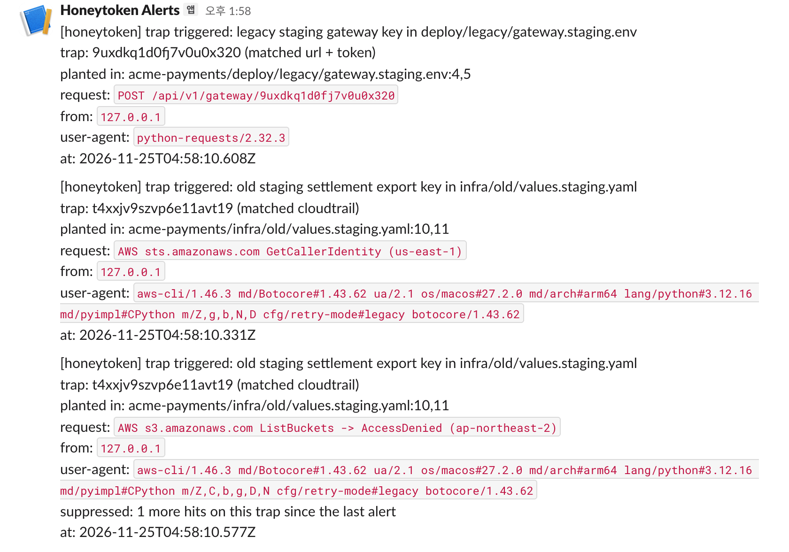
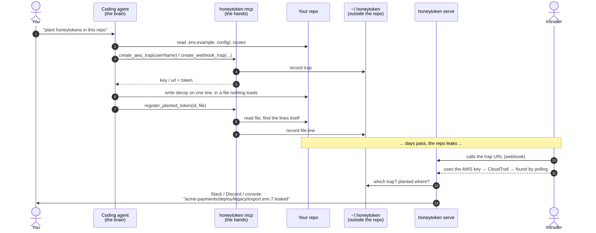

<div align="center">



<br>

**English** · [한국어](README.ko.md)

<br>

[](https://www.npmjs.com/package/honeytokens-as-code)
[](https://github.com/Dradradre/honeytokens-as-code/actions/workflows/ci.yml)
[](LICENSE)
[](package.json)
[](https://modelcontextprotocol.io)
[](#the-brain-and-the-hands)
[](#roadmap)

<h3>Your coding agent plants the canaries.<br>Not another canary that watches your agent.</h3>

<p>Say <code>plant honeytokens in this repo</code>. A minute later, real powerless AWS keys and internal-looking<br>webhook traps sit where an intruder would look, written in your repo's own accent, tracked and checked.</p>

<p><sub>Open-source honeytoken and canary token toolkit: an <b>MCP server</b>, an <b>Agent Skill</b> and a <b>CLI</b> that let<br><b>Claude Code</b>, <b>Cursor</b> and other AI coding agents plant <b>AWS canary credentials</b> and <b>webhook tripwires</b> in your<br>repositories, then alert you through <b>CloudTrail</b>, <b>Slack</b> or <b>Discord</b> when a leaked secret is used.</sub></p>

[How it works](#the-brain-and-the-hands) · [Two kinds of trap](#two-kinds-of-trap) · [Quickstart](#quickstart) · [Anatomy of an alert](#anatomy-of-an-alert) · [Paranoid by default](#paranoid-by-default) · [Reference](#reference)

</div>

<br>



<sub>Recorded from a real run: a separate Claude Code session got only the prompt above, the skill and the MCP server, and picked the
spots, names and prefixes itself in 50 s (20 turns, about $0.27). The AWS part ran against a local AWS emulator; the alerts went
through the real alert server to a real Slack channel:</sub>



<sub>The third message is the cooldown summary: the S3 attempt came seconds after the first call from the same address, so it was
held back and sent when the window closed instead of being dropped.</sub>

<br>

## Why this exists

Repos leak. A contractor's laptop gets popped, a CI token gets scraped, a private repo goes public for eleven
minutes. The first thing anyone does with a stolen repo is grep it for secrets and try them.

Honeytokens turn that grep against them: credentials that do nothing except tell you, loudly, that someone is
using them. The idea is old. The problem has always been the planting.

> **Not to be confused with** the many 2026 tools that plant canaries to catch a *misbehaving AI agent*
> (prompt injection, exfiltration). Honeytokens as Code points the other way: the agent is on your side, and the
> canaries are for whoever steals your repo, your CI or your laptop.


| | Classic canary tokens | Honeytokens as Code |
|---|---|---|
| **What the decoy looks like** | The same generic key, pasted in the same place | A real AWS key named like the repo's other service users, or an endpoint and token dressed as one of the repo's own internal services |
| **Who picks the spot** | You, by hand, in a hurry | Your coding agent, after reading how the repo is wired |
| **Will production call it by accident?** | Hopefully not | The playbook makes the agent prove nothing loads the file |
| **Where did it leak from?** | You check your notes | The alert says `acme-payments/deploy/legacy/export.env:7` |
| **Keeping it fresh** | Nobody remembers | `check_traps` flags lost or stale traps, `rotate_trap` swaps one in place |
| **After removal** | The token is dead, old leaks go unnoticed | The trap is *retired* and keeps watching: git history still holds the bait |

<br>

## The brain and the hands

Honeytokens as Code **never calls an LLM**. The model you already pay for is the brain; this tool is a small,
deterministic pair of hands that does only the parts that must be exactly right.



| Part | What it is | What it does |
|---|---|---|
| **Agent Skill** | [`skills/honeytoken-planting/SKILL.md`](skills/honeytoken-planting/SKILL.md) | A short playbook: study the repo's naming → pick a trap kind → plant where nothing loads it → register → verify |
| **MCP server** | `honeytoken mcp` | Eight tools: create (`aws`, `webhook`), `register_planted_token`, `list_traps`, `check_traps`, `rotate_trap`, `clean_traps`, `list_alerts` |
| **Alert server** | `honeytoken serve` | One process for every repo. Answers webhook hits, searches CloudTrail for AWS key use, logs, forwards to Slack and Discord |
| **CLI** | `honeytoken …` | Everything above, by hand |

<br>

## Two kinds of trap

| | 🔑 **AWS** | 🪝 **Webhook** |
|---|---|---|
| **What gets planted** | A real access key for an IAM user in **your** AWS account, with an explicit deny-all policy | A URL on your alert server and a token, named like an internal service: `pgw_live_…` next to `BILLING_GATEWAY_URL` |
| **When it fires** | Any AWS call with the key, even `sts get-caller-identity`, found in CloudTrail | Any request to the URL, or carrying the token |
| **Speed** | Minutes (CloudTrail delivery + poll interval) | Instant |
| **Catches tools that keep only keys that verify** | ✅ The key is real, and verifying it is the alarm | ❌ There is nothing to verify against |
| **Needs** | The `aws` CLI signed in to an account you may create IAM users in | Nothing; a public URL to catch real intruders |

This split follows how established canary products work: Thinkst Canarytokens and GitGuardian Honeytoken issue
real AWS keys and detect their use through CloudTrail (Rapid7 described the no-privilege IAM user behind the
idea in 2016), and Thinkst offers URL tokens for everything else.

> [!IMPORTANT]
> **Never fake a third-party provider's key.** We checked: GitHub push protection covers Stripe, Slack, OpenAI,
> Anthropic, GitHub, npm, SendGrid, Discord and AWS key formats and is on by default for public repos, so the
> commit that plants a fake `sk_live_` key gets blocked. Scanners like TruffleHog verify a key against the real
> provider and drop invalid ones, and an intruder who tries a fake Stripe key calls Stripe, never your URL.
> The tool refuses these formats (`sk_live_`, `ghp_`, `xoxb-`, `AKIA`, `sk-ant-`, …) unless the operator
> overrides it on the CLI.

<br>

## Quickstart

> [!TIP]
> Rather have a permanent command? `npm install -g honeytokens-as-code`, then `honeytoken init`.

**1. Set up** (once per machine)

```bash
npx honeytokens-as-code init
```

```text
✓ skill   ~/.claude/skills/honeytoken-planting/SKILL.md
✓ mcp     registered with Claude Code (user scope: no file in any repo)
✓ aws     AWS account 123456789012 reachable. Permissions needed: `honeytoken iam-policy issuer`
· alerts  HONEYTOKEN_BASE_URL is not set: webhook traps only fire on this machine. AWS traps need no public URL.
· next    Open your repo in Claude Code and say: plant honeytokens in this repo
```

`init` installs the agent skill, registers the MCP server with Claude Code at user scope, and checks your AWS
CLI. `--dry-run` shows what it would do. Without Claude Code it prints the config for other MCP clients.

**2. Watch** (pick one)

```bash
honeytoken watch       # AWS traps only, no server, no open port
honeytoken serve       # AWS traps + webhook traps (listens on 127.0.0.1:8787)
```

Or watch AWS traps from a scheduled GitHub Actions job with nothing running anywhere: see
[Watch AWS traps without a server](#watch-aws-traps-without-a-server). Slack and Discord forwarding:
`HONEYTOKEN_SLACK_WEBHOOK`, `HONEYTOKEN_DISCORD_WEBHOOK`.

<details>
<summary><b>Using AWS traps</b></summary>

<br>

AWS traps use the `aws` CLI you already have, with its usual profile, SSO and environment settings
(`AWS_PROFILE` and friends). Ideally point it at a **dedicated account** in your organization: the canary user
lives there, and nothing else does.

The identity that issues traps (`create aws`, `rotate`, `clean`, `check`) needs `sts:GetCallerIdentity` and
`iam:CreateUser`, `iam:PutUserPolicy`, `iam:GetUserPolicy`, `iam:DeleteUserPolicy`, `iam:CreateAccessKey`,
`iam:ListAccessKeys`, `iam:DeleteAccessKey`, `iam:DeleteUser`. The identity `honeytoken serve` runs as needs
`cloudtrail:LookupEvents` and `ec2:DescribeRegions`.

Every trap user gets an inline policy that denies everything, attached **before** its key exists. If issuing
fails halfway, the user is deleted again.

</details>

<details>
<summary><b>Cursor, Windsurf and other MCP clients</b></summary>

<br>

Register a stdio server with the command `honeytoken mcp` (or `node /abs/path/dist/cli.js mcp`) and
`HONEYTOKEN_BASE_URL` in its environment. Use your client's **user-level** config rather than a project file
you commit (see [Paranoid by default](#paranoid-by-default)). If the client has no skill support, paste
`SKILL.md` into its rules; the server also ships a condensed version of the playbook as MCP instructions.

</details>

**3. Ask**

```text
› plant honeytokens in this repo
```

**4. Prove it fires**

```bash
honeytoken list
curl -X POST <trap url>                                              # webhook: instant
AWS_ACCESS_KEY_ID=… AWS_SECRET_ACCESS_KEY=… aws sts get-caller-identity   # AWS: a few minutes
honeytoken alerts
```

**5. Keep them fresh**

```bash
honeytoken check       # still planted? due for rotation? AWS key intact? exits 1 if not (CI-friendly)
honeytoken rotate <id> # fresh value in the same lines; the old one keeps watching
```

<br>

## Watch AWS traps without a server

AWS traps need no listener: their use lands in CloudTrail, and anything that can read CloudTrail can raise the
alert. A scheduled GitHub Actions job in a **private ops repository** (never a repo that holds decoys) is enough:

1. **Role:** in the canary account, create an IAM role the ops repo can assume through GitHub OIDC, with
   `honeytoken iam-policy watcher` (only `cloudtrail:LookupEvents` and `ec2:DescribeRegions`).
2. **Secrets** in the ops repo: `HONEYTOKEN_AWS_ROLE` (the role ARN), `HONEYTOKEN_WATCHLIST` (the output of
   `honeytoken watchlist`: key ids and where each was planted, no secret keys), and `HONEYTOKEN_SLACK_WEBHOOK`
   and/or `HONEYTOKEN_DISCORD_WEBHOOK`.
3. **Workflow:** `honeytoken workflow > .github/workflows/honeytoken-watch.yml`, commit, done. It runs
   `watch --once` every 10 minutes and keeps its cursor in the Actions cache, so nothing alerts twice.

Re-export the watchlist after you plant, rotate or clean AWS traps.

<br>

## Going live

- **AWS traps** need nothing public: `honeytoken serve` polls CloudTrail from wherever it runs (default every
  5 minutes, `--aws-poll`), across every enabled region (`--aws-regions` to narrow).
- **Webhook traps** bake the alert URL in when they are created, so set `HONEYTOKEN_BASE_URL` **before** you
  plant. The default `http://127.0.0.1:8787` only fires on your machine. For real, run
  `honeytoken serve --host 0.0.0.0` somewhere the internet can reach (a small VPS, a reverse proxy, a tunnel),
  give it a copy of `~/.honeytoken/registry.json`, and use a hostname that looks like it belongs to you, e.g.
  `https://hooks.acme-internal.dev`. A decoy pointing at `ngrok-free.app` fools nobody.
- **Behind a proxy or tunnel,** tell the server which header holds the real client address, or every intruder
  shows up as your proxy and shares one cooldown: `--trust-proxy x-forwarded-for` behind a single nginx or Caddy,
  `--trust-proxy cf-connecting-ip` behind Cloudflare. Without the flag the header is ignored, because anyone
  can forge it.

<br>

## Anatomy of an alert

```text
[honeytoken] trap triggered: legacy export key
trap: m2x8c4k9q0w7e5r1t3y6 (matched cloudtrail)
planted in: acme-payments/deploy/legacy/export.env:7,8
request: `AWS s3.amazonaws.com ListBuckets -> AccessDenied (ap-northeast-2)`
from: `203.0.113.47`
user-agent: `Boto3/1.34.0 Python/3.12.1`
at: 2026-12-14T03:12:09.000Z
```

```text
[honeytoken] trap triggered: payments gateway key
trap: k3v9q2m8x1t7w0p4z6rb (matched url + token)
planted in: acme-payments/deploy/legacy/billing.env:7,8
request: `POST /api/v2/billing/webhook/k3v9q2m8x1t7w0p4z6rb`
from: `203.0.113.47`
user-agent: `python-requests/2.32.3`
at: 2026-12-14T03:12:09.114Z
```

Extra lines appear when they matter:

| Line | When |
|---|---|
| `(retired trap)` + `note: this trap was cleaned up, so an old copy of the repo is in use` | The hit came through a trap you removed or rotated: someone is working from history or an old clone |
| `likely: Slack link preview (link previews fetch URLs on their own)` | The user agent belongs to Slack, Discord, Teams, X, LinkedIn, WhatsApp, GitHub's image proxy or a search crawler |
| `suppressed: 41 more hits on this trap since the last alert` | Flood control held back repeats (one alert per trap and address per 10 min, at most 5 per trap per 10 min). When the window closes you get one summary: the latest held-back hit plus the count, so a second and third attempt never go unseen. Every hit is also in `alerts.jsonl` |

**What fires a trap**

| Trap | Signal | Reported as |
|---|---|---|
| AWS | Any API call signed with the key, allowed or denied, in any region, in CloudTrail event history | `cloudtrail` |
| Webhook | Trap id anywhere in the URL (any method, any path around it) | `url` |
| Webhook | Token in any header, HTTP Basic credentials, the query string or the body (first 64 KB) | `token` |

Requests that match nothing get a bland `404` and no alert, so scanners crawling your alert host don't page you
at 3 a.m.

<br>

## Paranoid by default

A honeytoken tool that gives itself away is worse than none. These are enforced in code and covered by tests:

| | |
|---|---|
| 🏠 **Nothing but the decoy touches your repo** | The map of every trap lives in `~/.honeytoken`, not in the repo: no lock file, no ignore entry (a committed ignore line would itself say "there are honeytokens here"), and `git clean` can't wipe it. The skill installs to `~/.claude/skills`, and `claude mcp add` uses local scope. |
| 🎭 **No fake provider keys, no telling names** | Known provider formats are refused (see above). Names an intruder will see (URL paths, token prefixes, IAM user names) are refused if they contain honey, canary, decoy, trap, fake, bait, lure or tripwire. |
| 🔒 **AWS canaries can never do anything** | Explicit deny-all on every canary user, attached before the key exists. `check` reports a key that disappeared or a policy someone stripped. |
| 🧭 **The agent can't pick the alert host** | The base URL comes only from `HONEYTOKEN_BASE_URL` or the CLI. A model that invents a convincing domain would build a trap that never fires. |
| 🔍 **Placements are verified, not trusted** | `register_planted_token` reads the file and finds the lines itself. It refuses unplanted traps, files outside a git repository or inside `.git`, and symlinks that lead out of the repo. `clean` and `rotate` check the real path again before they write. |
| 🪦 **Cleaning retires, it doesn't forget** | Removed and rotated traps keep alerting, AWS keys included. The decoy lives on in git history and every clone made before, and that is exactly the leak you want to hear about. |
| 🌊 **Floods stay small, nothing goes missing** | One alert per trap and address per cooldown, at most 5 per trap however many addresses an intruder rotates through, a summary of everything held back when the window closes, and an alert log that rotates at 10 MB. |
| 🧨 **Request data is treated as hostile** | Attacker-supplied fields are clipped and kept inside code spans; Slack text is escaped and Discord mentions are disabled, so nobody gets `@everyone`'d through your alert. |
| 💉 **Alerts can't steer your agent** | `list_alerts` hands the agent attacker-written fields labelled as untrusted data, and the skill forbids acting on them. A user agent saying "ignore previous instructions" stays a string. |
| 🥱 **The server is boring on purpose** | Hits get `401 {"error":"unauthorized"}` like any API rejecting a key. No banner, no version, no health endpoint. |
| 🔐 **Writes never collide** | The CLI and every MCP server share one registry under a lock file, written atomically with mode `0600`. Tested with four processes racing. |
| 🤐 **Secrets aren't echoed** | `list_traps` returns locations, not keys or tokens. |

<br>

## Architecture

Small on purpose, with seams where a second implementation is real:

```
src/
  core/        Web-standard only (Request, Response, URL, Web Crypto): runs on Node, Workers, Deno, Bun
  notify/      one file per channel: (alert) => Promise<void>
  store.ts     ~/.honeytoken: registry.json (locked, atomic), alerts.jsonl, cloudtrail.json
  aws.ts       AWS through your `aws` CLI: issue, rotate, delete, status, CloudTrail polling
  watch.ts     CloudTrail watching without a server: watchlists, one-shot polls, the poll loop
  service.ts   issue · issueAws · register · list · check · rotate · clean · alerts (every rule lives here)
  setup.ts     init, IAM policies, the GitHub Actions workflow
  server.ts    node:http → core.handle(), plus the CloudTrail watch loop
  mcp.ts       thin shell over the service
  cli.ts       thin shell over the service
```

The webhook path is one Web-standard function, so moving it to the edge is an adapter, not a rewrite:

```ts
import { handle, type Trap } from 'honeytokens-as-code/core';

export default {
  fetch: (req: Request, env: { TRAPS: KVNamespace }) =>
    handle(req, {
      traps: async () => (await env.TRAPS.get<Trap[]>('traps', 'json')) ?? [],
      onAlert: (alert) => console.log(JSON.stringify(alert)),
      clientIp: req.headers.get('cf-connecting-ip') ?? '',
    }),
};
```

| Entry point | For |
|---|---|
| `honeytokens-as-code/core` | `handle`, `generateWebhookTrap`, `trapsIn`, `formatAlert`, `PROVIDER_PREFIXES` and the types. No Node APIs. |
| `honeytokens-as-code/notify` | `slack`, `discord`, `createDispatcher` (cooldown), `notifiersFromEnv` |
| `honeytokens-as-code` | `createService()`: the same API the CLI and MCP server use |

<br>

## Reference

<details open>
<summary><b>MCP tools</b></summary>

<br>

| Tool | Input | Returns |
|---|---|---|
| `create_aws_trap` | `userName` (fits the repo), `label?` | `id`, `accessKeyId`, `secretAccessKey`, `userName`, `accountId`, `next`. Creates AWS resources |
| `create_webhook_trap` | `label?`, `pathPrefix?` (default `/v1/hooks`), `tokenPrefix?` (≤ 32 of `[A-Za-z0-9._-]`, no provider formats), `tokenLength?` (16–128, default 32), `tokenCharset?` (`alnum` \| `hex`) | `id`, `url`, `token`, `next`, and `warning` when no base URL is set |
| `register_planted_token` | `id`, `file` (absolute path preferred), `line?` (an assertion, not a hint) | the placements found |
| `list_traps` | `includeRetired?` | id, kind, label, status, target, createdAt, `repo/file:lines`. No secrets |
| `check_traps` | `maxAgeDays?` (default 180) | per active trap: file states (`ok` `moved` `gone` `missing` `refused`), age, `rotationDue`, AWS key and policy status, `needsAttention` |
| `rotate_trap` | `id` | new id, rewritten files. The old trap is retired and keeps alerting |
| `clean_traps` | `ids` **or** `all: true`, `dryRun?` | per trap: lines removed per file, `missing` and `refused` files, `forgotten`. Planted traps become `retired`; never-planted ones are deleted, AWS key included |
| `list_alerts` | `limit?` (1–200, default 20) | recent hits, oldest first, with an explicit "attacker-controlled" notice |

</details>

<details>
<summary><b>CLI</b></summary>

<br>

```text
honeytoken init              [--dry-run] [--base-url]       skill + MCP registration + AWS check
honeytoken create [webhook]  [--label] [--path-prefix] [--token-prefix] [--token-length] [--charset alnum|hex]
                             [--base-url] [--allow-provider-prefix]
honeytoken create aws        --user-name <name> [--label]
honeytoken register <id> <file> [--line n]
honeytoken list              [--all] [--json]
honeytoken check             [--max-age 180] [--json]       exit 1 when something needs attention
honeytoken rotate <id>
honeytoken clean <id...> | --all  [--dry-run]
honeytoken alerts            [--limit 20] [--json]
honeytoken serve             [--host 127.0.0.1] [--port 8787] [--cooldown 600] [--trust-proxy <header>]
                             [--aws-poll 300] [--aws-regions us-east-1,ap-northeast-2]
honeytoken watch             [--once] [--watchlist file] [--aws-poll 300] [--aws-regions …]
honeytoken watchlist                                        AWS traps to watch, no secret keys
honeytoken iam-policy        issuer|watcher
honeytoken workflow                                         GitHub Actions job for `watch --once`
honeytoken mcp
honeytoken install-skill     [--dir ~/.claude/skills]
honeytoken --version

global: --home <path>        (env HONEYTOKEN_HOME, default ~/.honeytoken)
```

</details>

<details>
<summary><b>Environment</b></summary>

<br>

| Variable | Used by | Meaning |
|---|---|---|
| `HONEYTOKEN_BASE_URL` | `create`, `mcp` | Public URL of your alert server (webhook traps). Default `http://127.0.0.1:8787` |
| `HONEYTOKEN_HOME` | all | Data directory: `registry.json`, `alerts.jsonl`, `cloudtrail.json`. Default `~/.honeytoken` |
| `HONEYTOKEN_WATCHLIST` | `watch` | Watchlist JSON to use instead of the registry (CI) |
| `HONEYTOKEN_SLACK_WEBHOOK` | `serve` | Slack incoming webhook URL |
| `HONEYTOKEN_DISCORD_WEBHOOK` | `serve` | Discord webhook URL |
| `AWS_PROFILE`, … | AWS traps | Read by the `aws` CLI as usual |

</details>

<details>
<summary><b><code>~/.honeytoken/registry.json</code></b></summary>

<br>

```json
{
  "version": 1,
  "traps": [
    {
      "id": "m2x8c4k9q0w7e5r1t3y6",
      "kind": "aws",
      "label": "legacy export key",
      "userName": "svc-billing-export",
      "accountId": "123456789012",
      "accessKeyId": "AKIA…",
      "secretAccessKey": "…",
      "status": "active",
      "createdAt": "2026-11-25T01:02:03.000Z",
      "placements": [
        { "repo": "/Users/you/src/acme-payments", "file": "deploy/legacy/export.env", "line": 7, "plantedAt": "2026-11-25T01:02:41.000Z" },
        { "repo": "/Users/you/src/acme-payments", "file": "deploy/legacy/export.env", "line": 8, "plantedAt": "2026-11-25T01:02:41.000Z" }
      ]
    },
    {
      "id": "k3v9q2m8x1t7w0p4z6rb",
      "kind": "webhook",
      "label": "payments gateway key",
      "url": "https://hooks.example.com/api/v2/billing/webhook/k3v9q2m8x1t7w0p4z6rb",
      "token": "pgw_live_Qm7rT2xVb9cWn4Lp8sYd…",
      "spec": { "pathPrefix": "/api/v2/billing/webhook", "tokenPrefix": "pgw_live_", "tokenLength": 24, "tokenCharset": "alnum" },
      "status": "active",
      "createdAt": "2026-11-25T01:05:00.000Z",
      "placements": []
    }
  ]
}
```

Written under a lock, atomically, with mode `0600`. Back the directory up somewhere private; without it,
`clean` can't find your traps. The alert server re-reads it on every request, so new traps are live without a
restart. Every hit is appended to `alerts.jsonl` next to it; at 10 MB that file becomes `alerts.1.jsonl` and a
new one starts.

</details>

<br>

## Threat model

| Scenario | Caught? |
|---|---|
| The repo leaks (public by mistake, stolen CI token, cloned by a contractor) and someone tries what they find | ✅ That is what this is for |
| An automated tool keeps only keys that verify against the provider | ✅ AWS traps (verifying the key is the alarm) · ❌ webhook traps |
| Someone works from an old clone or from git history after you cleaned up or rotated | ✅ Retired traps keep alerting |
| An intruder fingerprints canary keys before using them | ⚠️ TruffleHog recognises canarytokens.org AWS keys by account ID without calling AWS. Ours live in **your** account, so they are not on that list; a dedicated canary account is still a pattern a careful attacker could learn |
| The alert server is compromised | ❌ Its hostname gives away every webhook decoy that points at it. Keep it a box that does nothing else |
| **Your own machine is compromised** | ⚠️ Only if the intruder doesn't look first. `~/.honeytoken/registry.json` lists every decoy, and your coding agent's transcripts contain the values it was handed. Traps catch people who grep the repo, not people who read your home directory |

<br>

## Limitations, honestly

- **AWS alerts are minutes late.** CloudTrail delivers events in about 5 minutes on average and sometimes 15 or
  more, and the server polls every 5 minutes by default. Each poll re-reads the last 2 hours, so a late event
  still alerts, just late. Good enough to catch a leak, not to stop the first call.
- **Data-plane calls are invisible.** CloudTrail event history holds management events only. Reading or writing
  S3 objects, invoking Lambda functions or touching DynamoDB items with the key is not recorded there (that needs
  a data-event trail), so an intruder who only makes such calls is not caught. The first thing most people run
  with a found key, `aws sts get-caller-identity`, is a management event and is caught.
- **Not every AWS call reaches CloudTrail.** Researchers have used unlogged API calls to probe AWS identities
  quietly, so a careful intruder may be able to test a key without leaving an event. Anything they do with it
  beyond that is caught.
- **An explicit deny can be noticed.** AWS error messages may say the call hit an explicit deny. Locked-down
  service users exist in real accounts too, but it is a hint.
- **You host the alert server.** If it is down, webhook hits are lost (CloudTrail keeps AWS events for 90 days,
  so the poller catches up).
- **`list_alerts` reads the local log.** If the alert server runs on another machine, its `alerts.jsonl` is there.
- **A deliberate flood can rotate old log entries out.** Alerts already sent to Slack or Discord are unaffected.
- **`clean` and `rotate` work on whole lines.** That is why the playbook keeps every decoy on its own line.
- **The agent is only as careful as the playbook.** Review the diff before you commit it.

<br>

## Roadmap

- [x] Webhook traps dressed as internal services; provider formats refused
- [x] AWS canaries: real, powerless IAM keys found through CloudTrail
- [x] MCP server, Agent Skill, alert server, Slack and Discord forwarding
- [x] Alert cooldown, link-preview bot hints, alert log
- [x] Retired traps that keep watching; one registry for every repo
- [x] `check` for lost or stale traps, `rotate` in place
- [x] One-command `init`; AWS watching without a server (`watch`, GitHub Actions)
- [ ] Push instead of poll for AWS (EventBridge → alert server)
- [ ] GCP and Azure credential canaries
- [ ] Cloudflare Worker adapter (`core` already runs there)
- [ ] DNS traps
- [x] On npm: `npx honeytokens-as-code`
- [ ] Generic webhook and PagerDuty forwarding

<br>

## Contributing

```bash
git clone https://github.com/Dradradre/honeytokens-as-code && cd honeytokens-as-code
npm install
npm test             # node:test, runs TypeScript sources directly
npm run typecheck    # sources and tests
```

Read [`AGENTS.md`](AGENTS.md) first, whether you are a human or an agent. It lists the seams, the layer rules and
the security invariants a change must not break. A new alert channel is one file in `src/notify/`.
Found a vulnerability? Please report it privately: see [`SECURITY.md`](SECURITY.md).

<br>

## Sources

The trap design follows public research and vendor documentation:
[GitHub supported secret scanning patterns](https://docs.github.com/en/code-security/reference/secret-security/supported-secret-scanning-patterns) ·
[GitHub push protection for users](https://docs.github.com/en/code-security/how-tos/secure-your-secrets/prevent-future-leaks/push-protection-for-users) ·
[Behind GitHub's token formats](https://github.blog/engineering/platform-security/behind-githubs-new-authentication-token-formats/) ·
[TruffleHog detects AWS canaries](https://trufflesecurity.com/canaries) ·
[TruffleHog README](https://github.com/trufflesecurity/trufflehog) ·
[Thinkst AWS API key Canarytoken](https://blog.thinkst.com/2017/09/canarytokens-new-member-aws-api-key.html) ·
[GitGuardian Honeytoken FAQ](https://docs.gitguardian.com/honeytoken/frequently-asked-questions) ·
[Rapid7: AWS access keys as honeytokens](https://www.rapid7.com/blog/post/2016/11/30/early-warning-detectors-using-aws-access-keys-honeytokens/) ·
[CloudTrail LookupEvents](https://docs.aws.amazon.com/awscloudtrail/latest/APIReference/API_LookupEvents.html) ·
[STS endpoints and CloudTrail regions](https://docs.aws.amazon.com/IAM/latest/UserGuide/id_credentials_temp_region-endpoints.html) ·
[Rhino Security Labs: IAM enumeration bypassing CloudTrail](https://rhinosecuritylabs.com/aws/aws-iam-enumeration-2-0-bypassing-cloudtrail-logging/)

<br>

<div align="center">
<sub>MIT licensed.</sub>
<br><br>

</div>
