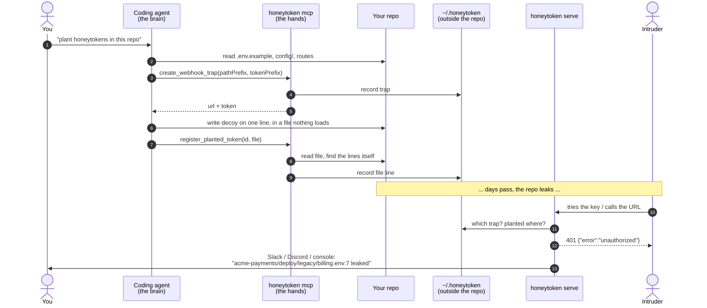

<div align="center">


<br>

**English** · [한국어](README.ko.md)

<br>

[](LICENSE)
[](package.json)
[](https://modelcontextprotocol.io)
[](#the-brain-and-the-hands)
[](#roadmap)

<h3>Tell your coding agent <code>plant honeytokens in this repo</code>.<br>A minute later, your repo is booby-trapped in its own accent.</h3>

[How it works](#the-brain-and-the-hands) · [Quickstart](#quickstart) · [Anatomy of an alert](#anatomy-of-an-alert) · [Paranoid by default](#paranoid-by-default) · [Architecture](#architecture) · [Reference](#reference)

</div>

<br>


<br>

## Why this exists

Repos leak. A contractor's laptop gets popped, a CI token gets scraped, a private repo goes public for eleven
minutes. The first thing anyone does with a stolen repo is grep it for secrets and try them.

Honeytokens turn that grep against them: fake credentials that do nothing except tell you, loudly, that
someone is using them. The idea is old. The problem has always been the planting:

| | Classic canary tokens | honeytoken-mcp |
|---|---|---|
| **What the decoy looks like** | The same generic key format every time | Whatever this repo already uses: `sk_live_…`, `/api/v2/billing/webhook`, your env var casing |
| **Who picks the spot** | You, by hand, in a hurry | Your coding agent, after reading how the repo is wired |
| **Will production call it by accident?** | Hopefully not | The playbook makes the agent prove nothing loads the file |
| **Where did it leak from?** | You check your notes | The alert says `deploy/legacy/billing.env:7` |
| **Removing it later** | Find and delete by hand | `clean_traps`: one call, with a dry run first |
| **After removal** | The token is dead, old leaks go unnoticed | The trap is *retired* and keeps watching: git history still holds the bait |

<br>

## The brain and the hands

honeytoken-mcp **never calls an LLM**. The model you already pay for is the brain; this tool is a small,
deterministic pair of hands that does only the parts that must be exactly right.



| Part | What it is | What it does |
|---|---|---|
| **Agent Skill** | [`skills/honeytoken-planting/SKILL.md`](skills/honeytoken-planting/SKILL.md) | A short playbook: study the repo's naming → issue a trap → plant it where nothing loads it → register → verify |
| **MCP server** | `honeytoken mcp` | Five tools, nothing more: `create_webhook_trap`, `register_planted_token`, `list_traps`, `clean_traps`, `list_alerts` |
| **Alert server** | `honeytoken serve` | One process for every repo. Matches hits to traps, logs them, forwards to Slack and Discord |
| **CLI** | `honeytoken …` | Everything above, by hand |

<br>

## Quickstart

> [!NOTE]
> Not on npm yet. Run it from a clone; it builds on `npm install`.

**1. Install**

```bash
git clone <this-repo-url> honeytoken-mcp && cd honeytoken-mcp
npm install            # builds dist/
npm link               # optional: puts `honeytoken` on your PATH
```

**2. Start the alert server** (in its own terminal)

```bash
export HONEYTOKEN_SLACK_WEBHOOK=https://hooks.slack.com/services/…     # optional
export HONEYTOKEN_DISCORD_WEBHOOK=https://discord.com/api/webhooks/…   # optional
honeytoken serve       # watches every repo you plant in; data lives in ~/.honeytoken
```

**3. Hand your agent the tools and the playbook**

```bash
honeytoken install-skill          # → ~/.claude/skills/honeytoken-planting/SKILL.md

cd /path/to/target-repo
claude mcp add honeytoken -e HONEYTOKEN_BASE_URL=http://127.0.0.1:8787 -- honeytoken mcp
```

<details>
<summary><b>Cursor, Windsurf and other MCP clients</b></summary>

<br>

Register a stdio server with the command `honeytoken mcp` (or `node /abs/path/dist/cli.js mcp`), the target
repo as its working directory, and `HONEYTOKEN_BASE_URL` in its environment. Use your client's **user-level**
config rather than a project file you commit (see [Paranoid by default](#paranoid-by-default)). If the client
has no skill support, paste `SKILL.md` into its rules; the server also ships a condensed version of the
playbook as MCP instructions.

</details>

**4. Ask**

```text
› plant honeytokens in this repo
```

**5. Prove it fires**

```bash
honeytoken list
curl -X POST <trap url>
honeytoken alerts
```

<br>

## Going live

The trap URL is baked in when the trap is created, so set `HONEYTOKEN_BASE_URL` **before** you plant.

- **Local (default):** `http://127.0.0.1:8787`. Good for trying it out; only fires on your machine.
- **For real:** run `honeytoken serve --host 0.0.0.0` behind something the internet can reach (a small VPS, a
  reverse proxy, a tunnel), give it a copy of `~/.honeytoken/registry.json`, and set `HONEYTOKEN_BASE_URL` to
  that public URL.
- **Behind a proxy or tunnel,** tell the server which header holds the real client address, or every intruder
  shows up as your proxy and shares one cooldown: `--trust-proxy x-forwarded-for` behind a single nginx or Caddy,
  `--trust-proxy cf-connecting-ip` behind Cloudflare. Without the flag the header is ignored, because anyone
  can forge it. Use a hostname that looks
  like it belongs to you, e.g. `https://hooks.acme-internal.dev`. A decoy pointing at `ngrok-free.app` fools
  nobody.

<br>

## Anatomy of an alert

```text
[honeytoken] trap triggered: legacy billing key
trap: k3v9q2m8x1t7w0p4z6rb (matched url + token)
planted in: acme-payments/deploy/legacy/billing.env:7,8
request: `POST /api/v2/billing/webhook/k3v9q2m8x1t7w0p4z6rb`
from: `203.0.113.47`
user-agent: `python-requests/2.32.3`
at: 2026-12-14T03:12:09.114Z
```

Extra lines appear when they matter:

| Line | When |
|---|---|
| `(retired trap)` + `note: this trap was cleaned up, so an old copy of the repo is in use` | The hit came through a trap you already removed: someone is working from history or an old clone |
| `likely: Slack link preview (link previews fetch URLs on their own)` | The user agent belongs to Slack, Discord, Teams, X, LinkedIn, WhatsApp, GitHub's image proxy or a search crawler |
| `suppressed: 41 more hits on this trap since the last alert` | Flood control held back repeats: one alert per trap and address per 10 min, and at most 5 per trap per 10 min however many addresses. Every hit is still in `alerts.jsonl` |

**What fires a trap**

| Where the trap shows up in a request | Reported as |
|---|---|
| Trap id anywhere in the URL (any method, any path around it) | `url` |
| Token in any header: `Authorization: Bearer …`, `X-API-Key`, cookies, anything | `token` |
| Token in HTTP Basic credentials, the query string or the body (first 64 KB) | `token` |

Everything else gets a bland `404` and no alert, so scanners crawling your alert host don't page you at 3 a.m.

<br>

## Paranoid by default

A honeytoken tool that gives itself away is worse than none. These are enforced in code and covered by tests:

| | |
|---|---|
| 🏠 **Nothing but the decoy touches your repo** | The map of every trap lives in `~/.honeytoken`, not in the repo: no lock file, no ignore entry (a committed ignore line would itself say "there are honeytokens here"), and `git clean` can't wipe it. The skill installs to `~/.claude/skills`, and `claude mcp add` uses local scope. |
| 🧭 **The agent can't pick the alert host** | The base URL comes only from `HONEYTOKEN_BASE_URL` or the CLI. A model that invents a convincing domain would build a trap that never fires. |
| 🔍 **Placements are verified, not trusted** | `register_planted_token` reads the file and finds the lines itself. It refuses unplanted traps, files outside a git repository or inside `.git`, and symlinks that lead out of the repo. `clean` checks the real path again before it writes. |
| 🌊 **Floods stay small** | One alert per trap and address per cooldown, at most 5 per trap however many addresses an intruder rotates through, and an alert log that rotates at 10 MB. |
| 🧨 **Request data is treated as hostile** | Attacker-supplied path and user agent are clipped and kept inside code spans; Slack text is escaped and Discord mentions are disabled, so nobody gets `@everyone`'d through your alert. |
| 🥱 **The server is boring on purpose** | Hits get `401 {"error":"unauthorized"}` like any API rejecting a key. No banner, no version, no health endpoint. |
| 🪦 **Cleaning retires, it doesn't forget** | Removed traps keep alerting. The decoy lives on in git history and every clone made before the cleanup, and that is exactly the leak you want to hear about. |
| 💉 **Alerts can't steer your agent** | `list_alerts` hands the agent attacker-written fields labelled as untrusted data, and the skill forbids acting on them. A user agent saying "ignore previous instructions" stays a string. |
| 🔐 **Writes never collide** | The CLI and every MCP server share one registry under a lock file, written atomically with mode `0600`. Tested with four processes racing. |
| 🤐 **Tokens aren't echoed** | `list_traps` returns locations, not secrets. |

> [!IMPORTANT]
> **A fake key alone is not a tripwire.** If an intruder tries a fake `sk_live_` key against the real Stripe,
> you hear nothing. The playbook therefore pairs every token with the trap URL in the endpoint variable next
> to it, so trying the key means calling your server.

<br>

## Architecture

Small on purpose, with seams where a second implementation is real:

```
src/
  core/        Web-standard only (Request, Response, URL, Web Crypto): runs on Node, Workers, Deno, Bun
  notify/      one file per channel: (alert) => Promise<void>
  store.ts     ~/.honeytoken: registry.json (locked, atomic) + alerts.jsonl
  service.ts   issue · register · list · clean · alerts (every rule lives here)
  server.ts    node:http → core.handle()
  mcp.ts       thin shell over the service
  cli.ts       thin shell over the service
```

The alert path is one Web-standard function, so moving it to the edge is an adapter, not a rewrite:

```ts
import { handle, type Trap } from 'honeytoken-mcp/core';

export default {
  fetch: (req: Request, env: { TRAPS: KVNamespace }) =>
    handle(req, {
      traps: async () => (await env.TRAPS.get<Trap[]>('traps', 'json')) ?? [],
      onAlert: (alert) => console.log(JSON.stringify(alert)),
      clientIp: req.headers.get('cf-connecting-ip') ?? '',
    }),
};
```

| Entry point | For |
|---|---|
| `honeytoken-mcp/core` | `handle`, `generateTrap`, `trapsIn`, `formatAlert` and the types. No Node APIs. |
| `honeytoken-mcp/notify` | `slack`, `discord`, `createDispatcher` (cooldown), `notifiersFromEnv` |
| `honeytoken-mcp` | `createService()`: the same API the CLI and MCP server use |

<br>

## Reference

<details open>
<summary><b>MCP tools</b></summary>

<br>

| Tool | Input | Returns |
|---|---|---|
| `create_webhook_trap` | `label?`, `pathPrefix?` (default `/v1/hooks`), `tokenPrefix?` (≤ 32 of `[A-Za-z0-9._-]`), `tokenLength?` (16–128, default 32), `tokenCharset?` (`alnum` \| `hex`) | `id`, `url`, `token`, `next`, and `warning` when no base URL is set |
| `register_planted_token` | `id`, `file` (absolute path preferred), `line?` (an assertion, not a hint) | the placements found |
| `list_traps` | `includeRetired?` | id, label, status, url, createdAt, `repo/file:lines`. No tokens. |
| `clean_traps` | `ids` **or** `all: true`, `dryRun?` | per trap: lines removed per file, `missing` and `refused` files, `forgotten`. Planted traps become `retired` and keep alerting; never-planted ones are deleted |
| `list_alerts` | `limit?` (1–200, default 20) | recent hits, oldest first, with an explicit "attacker-controlled" notice |

</details>

<details>
<summary><b>CLI</b></summary>

<br>

```text
honeytoken create          [--label] [--path-prefix] [--token-prefix] [--token-length] [--charset alnum|hex] [--base-url]
honeytoken register <id> <file> [--line n]
honeytoken list            [--all] [--json]
honeytoken clean <id...> | --all  [--dry-run]
honeytoken alerts          [--limit 20] [--json]
honeytoken serve           [--host 127.0.0.1] [--port 8787] [--cooldown 600] [--trust-proxy <header>]
honeytoken mcp
honeytoken install-skill   [--dir ~/.claude/skills]
honeytoken --version

global: --home <path>      (env HONEYTOKEN_HOME, default ~/.honeytoken)
```

</details>

<details>
<summary><b>Environment</b></summary>

<br>

| Variable | Used by | Meaning |
|---|---|---|
| `HONEYTOKEN_BASE_URL` | `create`, `mcp` | Public URL of your alert server. Default `http://127.0.0.1:8787` |
| `HONEYTOKEN_HOME` | all | Data directory: `registry.json`, `alerts.jsonl`. Default `~/.honeytoken` |
| `HONEYTOKEN_SLACK_WEBHOOK` | `serve` | Slack incoming webhook URL |
| `HONEYTOKEN_DISCORD_WEBHOOK` | `serve` | Discord webhook URL |

</details>

<details>
<summary><b><code>~/.honeytoken/registry.json</code></b></summary>

<br>

```json
{
  "version": 1,
  "traps": [
    {
      "id": "k3v9q2m8x1t7w0p4z6rb",
      "kind": "webhook",
      "label": "legacy billing key in deploy/legacy/billing.env",
      "url": "https://hooks.example.com/api/v2/billing/webhook/k3v9q2m8x1t7w0p4z6rb",
      "token": "sk_live_Qm7rT2xVb9cWn4Lp8sYd…",
      "status": "active",
      "createdAt": "2026-11-25T01:02:03.000Z",
      "placements": [
        { "repo": "/Users/you/src/acme-payments", "file": "deploy/legacy/billing.env", "line": 7, "plantedAt": "2026-11-25T01:02:41.000Z" },
        { "repo": "/Users/you/src/acme-payments", "file": "deploy/legacy/billing.env", "line": 8, "plantedAt": "2026-11-25T01:02:41.000Z" }
      ]
    }
  ]
}
```

Written under a lock, atomically, with mode `0600`. Back the directory up somewhere private; without it,
`clean` can't find your traps. The alert server re-reads it on every request, so new traps are live without a
restart. Every hit is appended to `alerts.jsonl` next to it; at 10 MB that file becomes `alerts.1.jsonl` and a
new one starts.

</details>

<br>

## Threat model

| Scenario | Caught? |
|---|---|
| The repo leaks (public by mistake, stolen CI token, cloned by a contractor) and someone tries what they find | ✅ That is what this is for |
| Someone works from an old clone or from git history after you cleaned up | ✅ Retired traps keep alerting |
| The alert server is compromised | ❌ Its hostname gives away every URL decoy that points at it. Keep it a box that does nothing else |
| **Your own machine is compromised** | ⚠️ Only if the intruder doesn't look first. `~/.honeytoken/registry.json` lists every decoy, and your coding agent's transcripts contain the tokens it was handed. Traps catch people who grep the repo, not people who read your home directory |

<br>

## Limitations, honestly

- **Webhook traps only.** No AWS / GCP / database credential canaries yet.
- **You host the alert server.** If it is down, hits are lost.
- **`list_alerts` reads the local log.** If the alert server runs on another machine, its `alerts.jsonl` is there.
- **A deliberate flood can rotate old log entries out.** Alerts already sent to Slack or Discord are unaffected.
- **`clean` deletes whole lines.** That is why the playbook keeps every decoy on its own line. Comments the
  agent wrote above a decoy are left for the agent to tidy.
- **The agent is only as careful as the playbook.** Review the diff before you commit it.

<br>

## Roadmap

- [x] Webhook / URL traps with repo-matched token formats
- [x] MCP server, Agent Skill, alert server, Slack and Discord forwarding
- [x] Alert cooldown, link-preview bot hints, alert log
- [x] Retired traps that keep watching; one registry for every repo
- [ ] Cloudflare Worker adapter (`core` already runs there)
- [ ] Cloud credential canaries (AWS IAM keys that alert through CloudTrail)
- [ ] DNS traps
- [ ] `npx honeytoken-mcp` on npm
- [ ] Generic webhook and PagerDuty forwarding
- [ ] Rotation: replace every trap in place, keeping the spots

<br>

## Contributing

```bash
npm install
npm test             # node:test, runs TypeScript sources directly
npm run typecheck
```

Read [`AGENTS.md`](AGENTS.md) first, whether you are a human or an agent. It lists the seams, the layer rules and
the security invariants a change must not break. A new alert channel is one file in `src/notify/`.

<br>

<div align="center">
<sub>MIT licensed. <code>honeytoken-mcp</code> is a working title.</sub>
<br><br>

</div>
